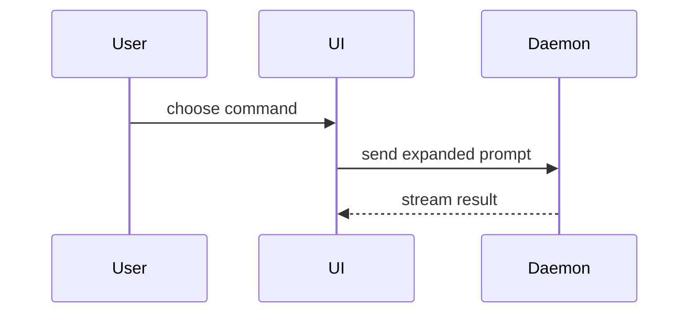

使用本模板编写 PR 正文：

```markdown
## Summary

<diagram, diff-sketch, or tree>

## Evidence

- **Before:** <screenshot/output/failing test run>
  **After:** <screenshot/output/passing test run>

## Merge Danger

**Door:** <one-way or two-way>

<optional: description>

**Blast Radius:** <one-word description>

<optional: potential ramifications of merge>
```

## Sections

省略所有开场白，文字保持简短。使用用户在 `GLOSSARY.md` 中的领域语言。

### Summary

选择能把关键点讲清楚的最小视图。

- 用伪代码展示逻辑或算法：

```text
on(save)
  if content is unchanged
    return cached result
  write new content
  return fresh result
```

- 用调用树展示运行时控制流程：

```text
submitForm
  createSession
    persistPrompt
    launchAgent
  navigateToSession
```

- 用组件树展示 UI 结构，包含重要状态和 module 边界：

```text
<SessionPage> (apps/example/src/routes/session.tsx)
  useSessionEvents()
  <SessionToolbar>
    <RunSkillButton> (packages/ui)
```

- 用浅层文件树展示文件职责或大范围重构：

```text
src/
├── commands/       # parses user actions
├── sessions/       # owns session state
└── transport/      # sends API requests
```

- 用 Mermaid 展示组件交互、控制流或数据流：



- 当重点是改了什么，且周围形状已经存在时，使用 `diff`。使 diff 形状符合话题。

对于组件改动：

```diff
 <SessionPage>
   useSessionEvents()
   <SessionToolbar>
+    <RunSkillButton />
   <SessionTimeline>
+    <SkillResultCard />
```

对于文件布局改动：

```diff
 src/
 ├── commands/
+│   └── show-me.ts       # expands the slash command
 ├── sessions/
-└── transport.ts
+└── transport/
+    ├── client.ts
+    └── stream.ts
```

对于调用树或调用栈改动：

```diff
 submitForm
   createSession
     persistPrompt
+    expandSkillMention
     launchAgent
-  navigateToSession
+  navigateToSession
+    subscribeToEvents
```

对于状态或控制流改动：

```diff
 on(save)
-  write content
+  if content is unchanged
+    return cached result
+  write new content
+  invalidate cache
```

- 大部分内容是新增、省略背景会隐藏归属或顺序，或用户需要可复制的目标形状时，展示完整代码块：

```ts
function expandSkill(command: string): string {
  const skillName = command.slice(1);
  return `use the ${skillName} skill`;
}
```

#### Guidance

将每个可视化紧邻其支持的简短文字。只保留回答用户当前问题、或帮助解决当前讨论所需的调用、文件、prop、state 和边界。

可以用一种，也可以用几种，通常不需要全部使用。运用判断，不要淹没用户。

### Evidence

提供改动有效的具体证据，展示前后对比。

环境支持且改动可视时，截图是 S 级证据。

基于执行的证据是 A 级：测试结果、console 输出。用伪代码展示哪个确切测试先失败、后通过。

### Merge Danger

描述它是单向门还是双向门。双向门可以退回来，单向门不行。低成本回滚的 PR 风险更低。包含破坏性动作或难以逆转决策的改动是单向门。

blast radius 是此 PR 改动可能造成的影响或范围。考虑所有可能性，例如布局偏移、消费者故障、移动端适配等。
