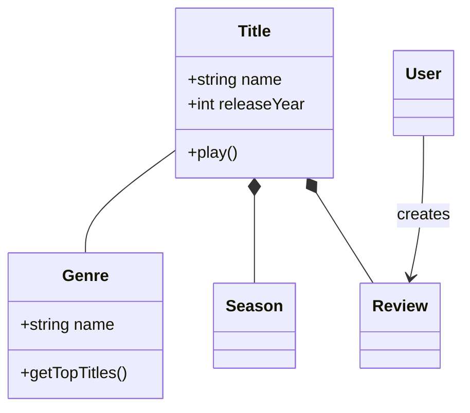
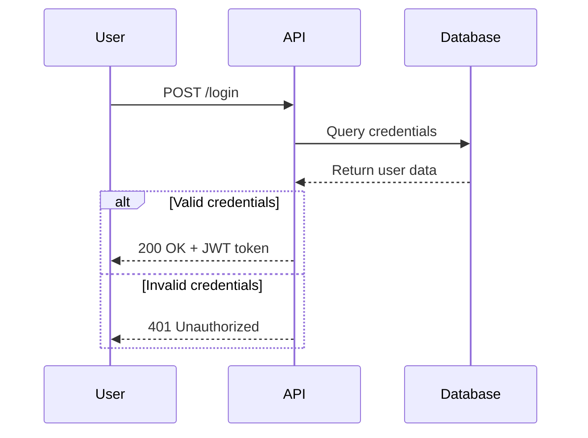
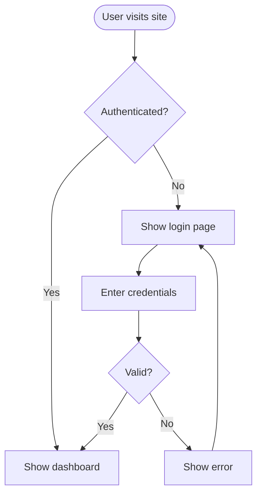
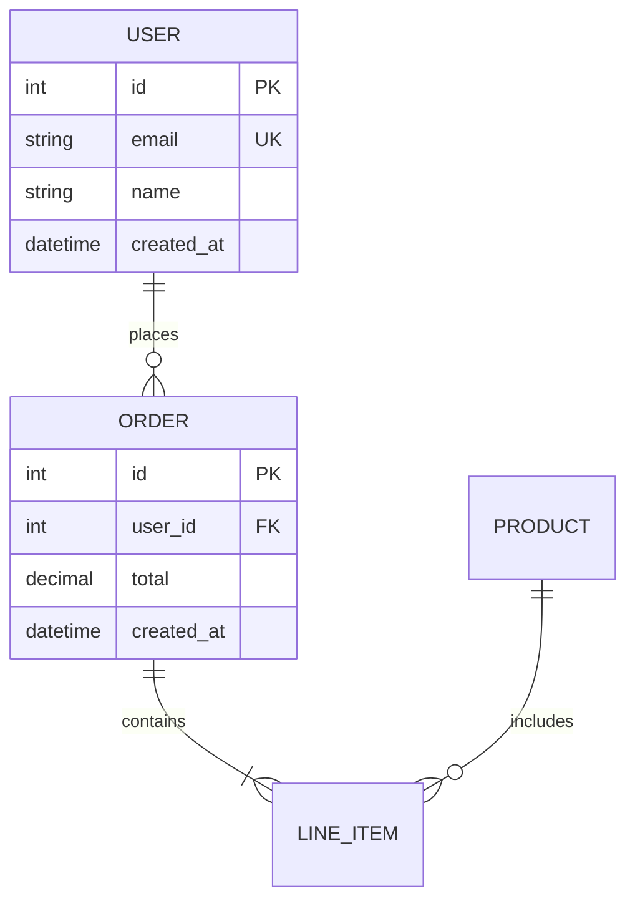
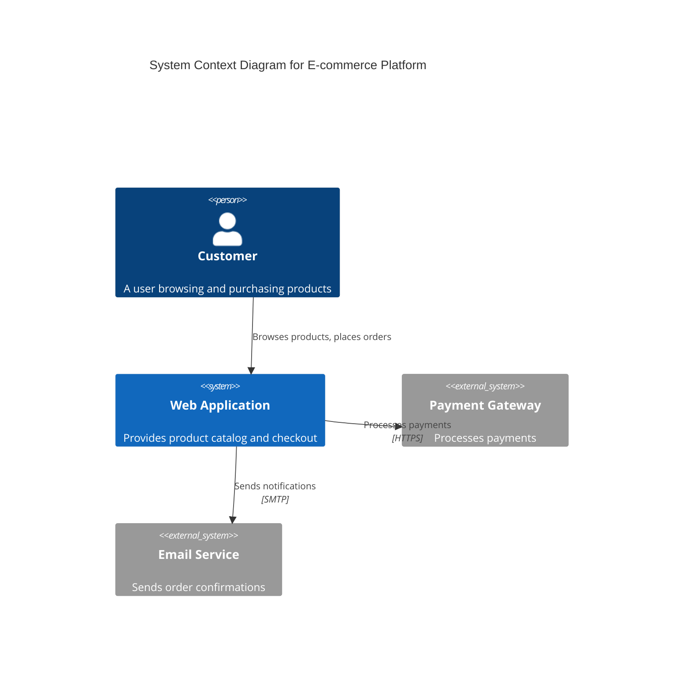

# Mermaid Diagrams Skill

使用 Mermaid 文本语法创建专业软件图表的完整指南。本 skill 帮助你可视化系统架构、记录代码结构、建模数据库，并通过图表沟通技术概念。

## Purpose

将复杂技术概念转成清楚、可维护的图表，与代码一起进行版本控制。Mermaid 从简单文本定义渲染图表，因此易于更新、在 pull request 中审查，以及长期维护。

## When to Use This Skill

需要以下工作时使用本 skill：

- **记录架构** -- 展示系统上下文、容器、组件与部署
- **领域建模** -- 创建包含实体、关系与行为的领域模型
- **解释流程** -- 展示 API 交互、用户旅程、认证时序
- **设计数据库** -- 记录表关系、键和 schema 结构
- **规划过程** -- 描绘工作流、决策树、算法与流水线
- **沟通设计** -- 编码前让相关方就技术决策达成一致

### Trigger Phrases

提及以下内容时会激活：
- "diagram"、"visualize"、"model"、"map out"、"show the flow"
- "architecture diagram"、"class diagram"、"sequence diagram"、"flowchart"
- "database schema"、"ERD"、"entity relationship"
- "system design"、"data model"、"domain model"

## How It Works

1. 根据沟通目的，**选择合适图表类型**
2. **从核心元素开始** -- 实体、角色或组件
3. **添加关系** -- 连接、流程、交互
4. **逐步完善** -- 增加细节、样式与注释
5. **导出或嵌入** -- 用于文档、PR、Wiki

Mermaid 语法直观，各类图表都遵循一致的形式：

```mermaid
diagramType
  definition content
```

## Key Features

### 9 Diagram Types Supported

1. **Class Diagrams（类图）** -- 领域模型、OOP 设计、实体关系
2. **Sequence Diagrams（时序图）** -- API 流程、用户交互、时间序列
3. **Flowcharts（流程图）** -- 用户旅程、过程、决策逻辑、流水线
4. **Entity Relationship Diagrams（实体关系图）** -- 数据库 schema、表关系
5. **C4 Architecture Diagrams（C4 架构图）** -- 系统上下文、容器、组件
6. **State Diagrams（状态图）** -- 状态机、生命周期状态
7. **Git Graphs（Git 图）** -- 分支策略、版本控制流程
8. **Gantt Charts（甘特图）** -- 项目时间线、排期
9. **Pie/Bar Charts（饼图与柱状图）** -- 数据可视化、指标

### Advanced Capabilities

- **主题与样式** -- default、forest、dark、neutral、base 主题
- **自定义主题** -- 配置颜色、字体和布局
- **布局选项** -- Dagre（均衡）或 ELK（高级）
- **外观选项** -- 经典风格或手绘草图风格
- **子图** -- 为清楚表达而归组相关元素
- **注释与说明** -- 补充上下文和解释
- **Alt/loop/opt 块** -- 时序图中的复杂流程控制

### Integration Support

- **GitHub/GitLab** -- 在 Markdown 文件中自动渲染
- **VS Code** -- 通过 Markdown Mermaid 扩展预览
- **Notion、Obsidian、Confluence** -- 内置支持
- **导出** -- 通过 Mermaid Live 或 CLI 导出 PNG、SVG、PDF

## Usage Examples

### Example 1: Document a Domain Model

**使用情形：** 设计视频流平台，需要建模核心实体。



### Example 2: Explain an API Authentication Flow

**使用情形：** 向前端开发者记录登录流程。



### Example 3: Map a User Journey

**使用情形：** 规划功能，需要可视化用户流程。



### Example 4: Design a Database Schema

**使用情形：** 规划新功能的表关系。



### Example 5: Visualize System Architecture (C4)

**使用情形：** 展示系统与外部服务如何交互。



## Getting Started

1. **明确沟通内容** -- 架构、流程，还是数据模型？
2. **选择合适图表类型** -- 见 SKILL.md 中的 Diagram Type Selection Guide
3. **从简单开始** -- 先加入核心实体或组件
4. **添加关系** -- 用适当连接符连接元素
5. **完善样式** -- 添加细节、注释和自定义主题
6. **验证** -- 在 [Mermaid Live Editor](https://mermaid.live) 中测试
7. **嵌入或导出** -- 用于 Markdown、导出图片或进行集成

## Detailed References

完整语法和高级功能见：

- **[SKILL.md](SKILL.md)** -- 快速入门和图表选择
- **[references/class-diagrams.md](references/class-diagrams.md)** -- 关系、多重性、方法
- **[references/sequence-diagrams.md](references/sequence-diagrams.md)** -- 消息、激活、循环、alt 块
- **[references/flowcharts.md](references/flowcharts.md)** -- 节点形状、决策逻辑、子图
- **[references/erd-diagrams.md](references/erd-diagrams.md)** -- 基数、键、属性
- **[references/c4-diagrams.md](references/c4-diagrams.md)** -- 上下文、容器、组件层次
- **[references/architecture-diagrams.md](references/architecture-diagrams.md)** -- 云服务、基础设施、CI/CD 部署
- **[references/advanced-features.md](references/advanced-features.md)** -- 主题、样式、配置

## Best Practices

1. **从简单开始，持续迭代** -- 先画核心元素，再逐步增加复杂度
2. **一张图，一个概念** -- 保持聚焦，拆分过大的视图
3. **有意义的名称** -- 清楚的标签让图表自行说明含义
4. **充分注释** -- 用 `%%` 解释不明显的关系
5. **版本控制** -- `.mmd` 文件与代码一起存储，随系统演进更新
6. **补充上下文** -- 包含说明图表目的的标题和注释
7. **验证语法** -- 提交前在 Mermaid Live 测试
8. **保持可读** -- 不要过度拥挤；必要时拆成多图

## Common Use Cases

- **入职引导** -- 帮助新成员理解系统结构
- **设计审查** -- 实施前可视化提案
- **文档** -- 创建随代码演进的活文档
- **架构决策** -- 就技术选择达成一致
- **重构** -- 用变更前后图表规划结构调整
- **API 交接** -- 记录前后端协作流程
- **数据库迁移** -- 可视化 schema 变更

## Tips for Success

- **逐步测试** -- 绘图过程中持续验证语法，尽早发现错误
- **命名一致** -- 图表名称与代码、数据库名称保持一致
- **利用 GitHub 渲染** -- 图表在 `.md` 文件中自动显示
- **用于演示导出** -- 用 Mermaid Live 或 CLI 导出高分辨率图片
- **协作** -- 图表适合 PR 讨论和设计文档
- **保持更新** -- 代码变化时更新图表，避免失配

## Tools and Resources

- **[Mermaid Live Editor](https://mermaid.live)** -- 交互式编辑器，即时预览与导出
- **[Official Documentation](https://mermaid.js.org)** -- 完整语法参考
- **Mermaid CLI** -- `npm install -g @mermaid-js/mermaid-cli`，用于批量导出
- **VS Code Extension** -- "Markdown Preview Mermaid Support"，用于实时预览
- **GitHub** -- 原生渲染所有 `.md` 文件中的图表

## Support

遇到问题、需要语法帮助或高级功能时，参见：
- SKILL.md：速查
- `references/` 中的参考文件：详细语法
- [Mermaid official docs](https://mermaid.js.org)：最新功能
