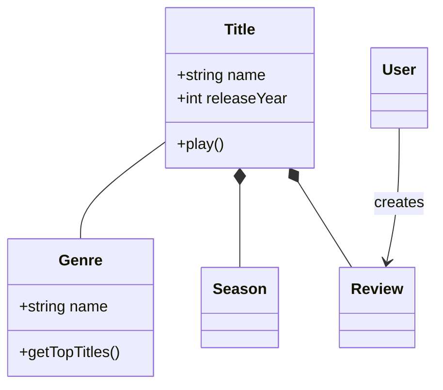
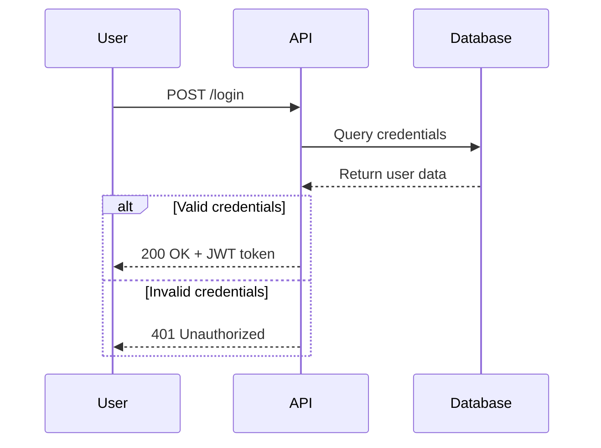
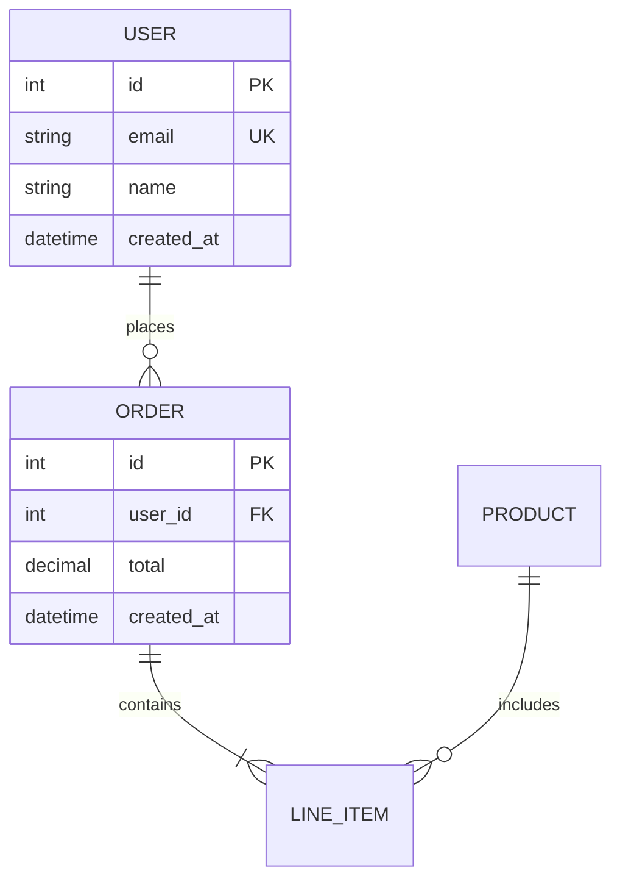
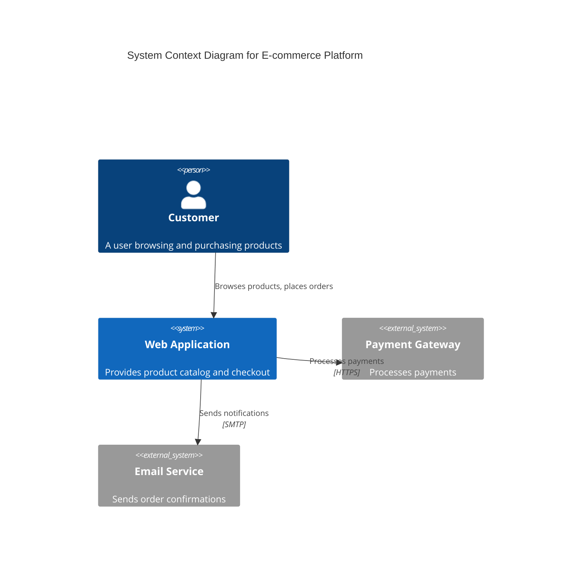

# Mermaid Diagrams Skill

使用 Mermaid 的 text-based syntax 创建专业 software diagrams 的完整指南。本 skill 使你能够可视化 system architecture、记录 code structure、为 databases 建模，并通过图表交流 technical concepts。

## Purpose

将复杂的 technical concepts 转化为清晰、可维护且能与 code 一起进行 version control 的图表。Mermaid 图表从简单的文本定义渲染而成，因此易于更新、在 pull requests 中审查，并长期维护。

## When to Use This Skill

需要以下工作时使用本 skill：

- **记录 architecture** - 可视化 system context、containers、components 和 deployment
- **为 domains 建模** - 创建包含 entities、relationships 和 behaviors 的 domain models
- **解释 flows** - 展示 API interactions、user journeys、authentication sequences
- **设计 databases** - 记录 table relationships、keys 和 schema structure
- **规划过程** - 描绘 workflows、decision trees、algorithms 和 pipelines
- **交流设计** - 在编码前让 stakeholders 就 technical decisions 达成一致

### Trigger Phrases

提及以下内容时会激活：
- "diagram"、"visualize"、"model"、"map out"、"show the flow"
- "architecture diagram"、"class diagram"、"sequence diagram"、"flowchart"
- "database schema"、"ERD"、"entity relationship"
- "system design"、"data model"、"domain model"

## How It Works

1. 根据想要交流的内容，**选择合适的 diagram type**
2. **从核心 elements 开始** - entities、actors 或 components
3. **添加 relationships** - connections、flows、interactions
4. **逐步完善** - 添加细节、styling 和 notes
5. **导出或嵌入** - 用于 documentation、PRs、wikis

Mermaid syntax 直观，而且所有 diagram types 都遵循一致的模式：

```mermaid
diagramType
  definition content
```

## Key Features

### 9 Diagram Types Supported

1. **Class Diagrams** - Domain models, OOP design, entity relationships
2. **Sequence Diagrams** - API flows、user interactions、随时间发生的 sequences
3. **Flowcharts** - User journeys、过程、decision logic、pipelines
4. **Entity Relationship Diagrams** - Database schemas, table relationships
5. **C4 Architecture Diagrams** - System context, containers, components
6. **State Diagrams** - State machines, lifecycle states
7. **Git Graphs** - Branching strategies, version control flows
8. **Gantt Charts** - Project timelines、排期
9. **Pie/Bar Charts** - Data visualization, metrics

### Advanced Capabilities

- **Themes 和 styling** - Default、forest、dark、neutral、base themes
- **自定义 theming** - 配置 colors、fonts 和 layout
- **Layout 选项** - Dagre（均衡）或 ELK（高级）
- **Look 选项** - Classic 或手绘草图 style
- **Subgraphs** - 将相关 elements 分组，使表达清晰
- **Notes 和 comments** - 添加上下文和解释
- **Alt/loop/opt blocks** - Sequences 中复杂的 flow control

### Integration Support

- **GitHub/GitLab** - 在 Markdown 文件中自动渲染
- **VS Code** - 通过 Markdown Mermaid extension 预览
- **Notion、Obsidian、Confluence** - 内置支持
- **导出** - 通过 Mermaid Live 或 CLI 导出 PNG、SVG、PDF

## Usage Examples

### Example 1: Document a Domain Model

**使用时机：** 你正在设计一个 video streaming platform，需要为核心 entities 建模。



### Example 2: Explain an API Authentication Flow

**使用时机：** 你需要向 frontend developers 记录 login 的工作方式。



### Example 3: Map a User Journey

**使用时机：** 你正在规划一个 feature，需要可视化 user flow。


### Example 4: Design a Database Schema

**使用时机：** 你正在为一个新 feature 规划 table relationships。



### Example 5: Visualize System Architecture (C4)

**使用时机：** 你需要展示 systems 和 external services 如何交互。



## Getting Started

1. **明确需要交流什么** - Architecture？Flow？Data model？
2. **选择适当的 diagram type** - 参见 SKILL.md 中的 "Diagram Type Selection Guide"
3. **从简单开始** - 先添加核心 entities/components
4. **添加 relationships** - 使用适当的 connectors 连接 elements
5. **完善并设置 style** - 添加细节、notes 和自定义 theming
6. **验证** - 在 [Mermaid Live Editor](https://mermaid.live) 中测试
7. **嵌入或导出** - 在 Markdown 中使用、导出为 image，或进行集成

## Detailed References

完整语法和高级功能见：

- **[SKILL.md](SKILL.md)** - 快速入门指南和 diagram 选择
- **[references/class-diagrams.md](references/class-diagrams.md)** - Relationships, multiplicity, methods
- **[references/sequence-diagrams.md](references/sequence-diagrams.md)** - Messages, activations, loops, alt blocks
- **[references/flowcharts.md](references/flowcharts.md)** - Node shapes, decision logic, subgraphs
- **[references/erd-diagrams.md](references/erd-diagrams.md)** - Cardinality, keys, attributes
- **[references/c4-diagrams.md](references/c4-diagrams.md)** - Context, container, component levels
- **[references/architecture-diagrams.md](references/architecture-diagrams.md)** - Cloud services, infrastructure, CI/CD deployments
- **[references/advanced-features.md](references/advanced-features.md)** - Themes, styling, configuration

## Best Practices

1. **从简单开始，持续迭代** - 从核心 elements 开始，逐步增加复杂度
2. **一张 diagram，一个概念** - 保持 diagrams 聚焦，并拆分大型 views
3. **使用有意义的名称** - 清晰的 labels 使图表 self-documenting
4. **充分编写 comments** - 使用 `%%` 解释不明显的 relationships
5. **Version control** - 将 `.mmd` 文件与 code 放在一起，随着 system 演进更新
6. **添加上下文** - 包含解释图表目的的 titles 和 notes
7. **验证 syntax** - 在 commit 前用 Mermaid Live 测试
8. **保持可读性** - 不要过度拥挤；必要时拆成多个 diagrams

## Common Use Cases

- **Onboarding** - 帮助新团队成员理解 system structure
- **Design reviews** - 在 implementation 之前可视化 proposals
- **Documentation** - 创建随 code 演进的 living docs
- **Architecture decisions** - 让 stakeholders 就 technical choices 达成一致
- **Refactoring** - 使用 before/after diagrams 规划结构调整
- **API handoffs** - 记录用于 frontend/backend 协作的 flows
- **Database migrations** - 可视化 schema changes

## Tips for Success

- **逐步测试** - 在构建过程中验证 syntax，尽早发现错误
- **保持命名一致** - 让 diagram names 与 code/database names 匹配
- **利用 GitHub rendering** - Diagrams 会在 `.md` 文件中自动出现
- **为 presentations 导出** - 使用 Mermaid Live 或 CLI 进行 high-res exports
- **协作** - Diagrams 很适合 PR discussions 和 design docs
- **保持更新** - Code 变更时更新 diagrams，避免 drift

## Tools and Resources

- **[Mermaid Live Editor](https://mermaid.live)** - 具有即时 preview 和 export 功能的交互式 editor
- **[Official Documentation](https://mermaid.js.org)** - 完整的 syntax reference
- **Mermaid CLI** - `npm install -g @mermaid-js/mermaid-cli`，用于 batch exports
- **VS Code Extension** - "Markdown Preview Mermaid Support"，用于 live preview
- **GitHub** - 在所有 `.md` 文件中原生渲染

## Support

遇到问题、需要语法帮助或高级功能时，参见：
- SKILL.md：quick reference
- `references/` 中的 reference files：详细 syntax
- [Mermaid official docs](https://mermaid.js.org)：最新 features
