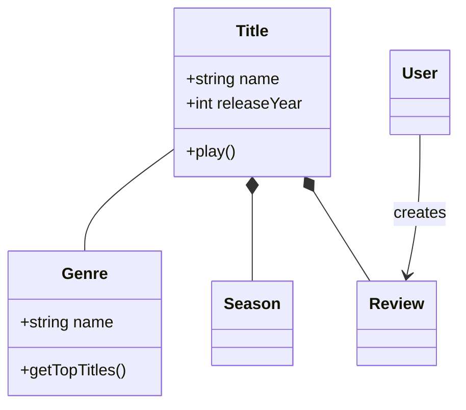
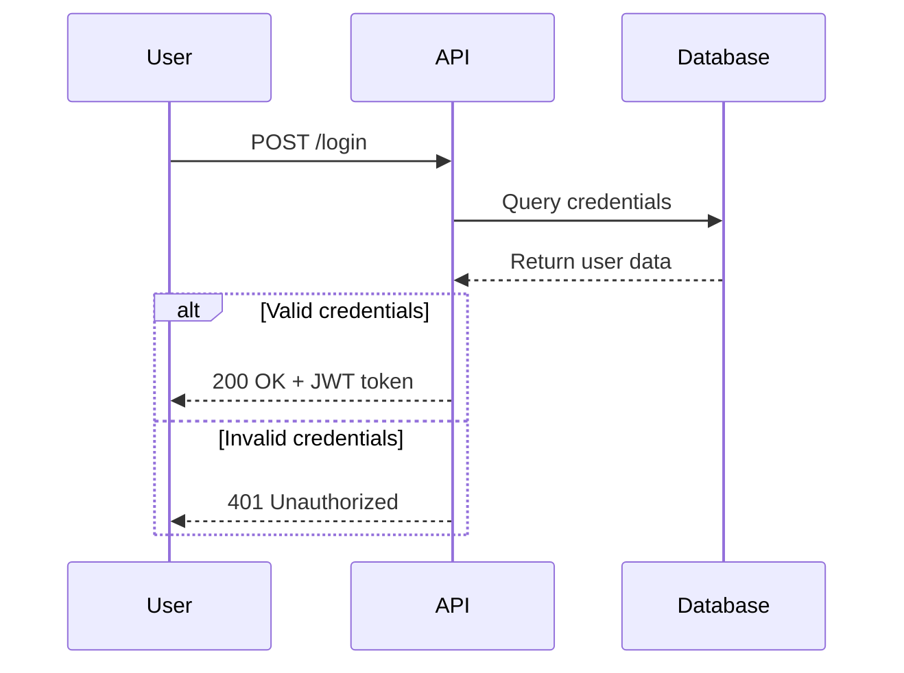
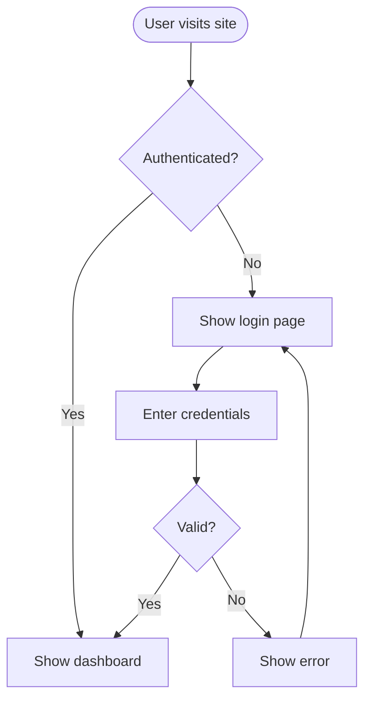
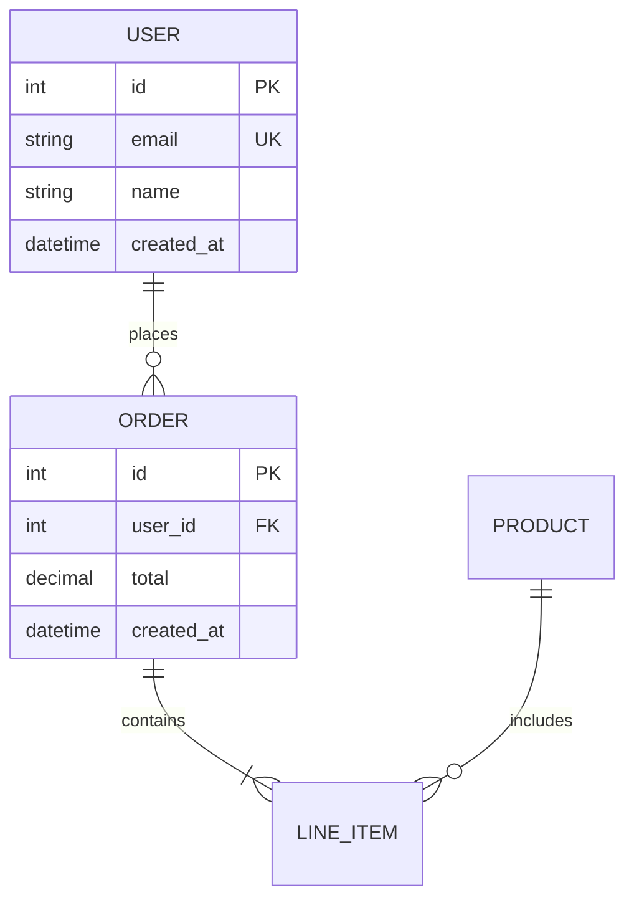
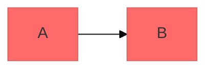

# Mermaid Diagramming

使用 Mermaid 的 text-based syntax 创建专业的 software diagrams。Mermaid 从简单的文本定义渲染图表，使图表能够进行 version control、易于更新，并可与 code 一起维护。

## Core Syntax Structure

所有 Mermaid 图表均遵循以下形式：

```mermaid
diagramType
  definition content
```

**关键原则：**
- 首行声明 diagram type（例如 `classDiagram`、`sequenceDiagram`、`flowchart`）
- 使用 `%%` 编写 comments
- Line breaks 和 indentation 提高可读性，但不是必需的
- 无法识别的词会导致图表出错；parameters 会静默失败

## Diagram Type Selection Guide

**选择合适的 diagram type：**

1. **Class Diagrams** - Domain modeling, OOP design, entity relationships
   - Domain-driven design 文档
   - Object-oriented class structures
   - Entity relationships 和 dependencies

2. **Sequence Diagrams** - 随时间发生的 interactions、message flows
   - API request/response flows
   - User authentication flows
   - System component interactions
   - Method call sequences

3. **Flowcharts** - 过程、algorithms、decision trees
   - User journeys 和 workflows
   - Business processes
   - Algorithm logic
   - Deployment pipelines

4. **Entity Relationship Diagrams (ERD)** - Database schemas
   - Table relationships
   - Data modeling
   - Schema design

5. **C4 Diagrams** - 多个层级的 software architecture
   - System Context（systems 和 users）
   - Container（applications、databases、services）
   - Component（内部结构）
   - Code（class/interface 层级）

6. **State Diagrams** - State machines, lifecycle states
7. **Git Graphs** - Version control branching strategies
8. **Gantt Charts** - Project timelines、排期
9. **Pie/Bar Charts** - Data visualization

## Quick Start Examples

### Class Diagram (Domain Model)


### Sequence Diagram (API Flow)


### Flowchart (User Journey)


### ERD (Database Schema)


## Detailed References

各图表类型的深入指导见：

- **[references/class-diagrams.md](references/class-diagrams.md)** - Domain modeling, relationships (association, composition, aggregation, inheritance), multiplicity, methods/properties
- **[references/sequence-diagrams.md](references/sequence-diagrams.md)** - Actors, participants, messages (sync/async), activations, loops, alt/opt/par blocks, notes
- **[references/flowcharts.md](references/flowcharts.md)** - Node shapes, connections, decision logic, subgraphs, styling
- **[references/erd-diagrams.md](references/erd-diagrams.md)** - Entities, relationships, cardinality, keys, attributes
- **[references/c4-diagrams.md](references/c4-diagrams.md)** - System context, container, component diagrams, boundaries
- **[references/architecture-diagrams.md](references/architecture-diagrams.md)** - Cloud services, infrastructure, CI/CD deployments
- **[references/advanced-features.md](references/advanced-features.md)** - Themes, styling, configuration, layout options

## Best Practices

1. **从简单开始** - 从核心 entities/components 开始，逐步添加细节
2. **使用有意义的名称** - 清晰的 labels 使图表 self-documenting
3. **充分编写 comments** - 使用 `%%` comments 解释复杂的 relationships
4. **保持聚焦** - 每个概念使用一张 diagram；将大型 diagrams 拆成多个聚焦的 views
5. **Version Control** - 将 `.mmd` 文件与 code 放在一起，便于更新
6. **添加上下文** - 包含 titles 和 notes，说明图表目的
7. **迭代** - 随着理解加深，不断完善图表

## Configuration and Theming

通过 frontmatter 配置图表：



**可用 themes：** default、forest、dark、neutral、base

**Layout 选项：**
- `layout: dagre`（默认）- 经典的均衡 layout
- `layout: elk` - 用于复杂图表的高级 layout（需要集成）

**Look 选项：**
- `look: classic` - 传统 Mermaid style
- `look: handDrawn` - 草图般的外观

## Exporting and Rendering

**原生支持：**
- GitHub/GitLab - 在 Markdown 中自动渲染
- VS Code - 通过 Markdown Mermaid extension 支持
- Notion、Obsidian、Confluence - 内置支持

**导出选项：**
- [Mermaid Live Editor](https://mermaid.live) - 支持 PNG/SVG 导出的在线 editor
- Mermaid CLI - 先 `npm install -g @mermaid-js/mermaid-cli`，再 `mmdc -i input.mmd -o output.png`
- Docker - `docker run --rm -v $(pwd):/data minlag/mermaid-cli -i /data/input.mmd -o /data/output.png`

## Common Pitfalls

- **会导致出错的字符** - 在 comments 中避免 `{}`，对特殊字符使用正确的 escape sequences
- **Syntax errors** - 拼写错误会导致图表出错；在 Mermaid Live 中验证 syntax
- **过度复杂** - 将复杂图表拆成多个聚焦的 views
- **缺少 relationships** - 记录 entities 之间所有重要的 connections

## When to Create Diagrams

**以下情形始终画图：**
- 启动新项目或功能
- 记录复杂系统
- 解释 architecture decisions
- 设计 database schemas
- 规划 refactoring 工作
- 为新团队成员开展 onboarding

**使用图表来：**
- 让 stakeholders 就 technical decisions 达成一致
- 协作记录 domain models
- 可视化 data flows 和 system interactions
- 编码前规划
- 创建随 code 演进的 living documentation
