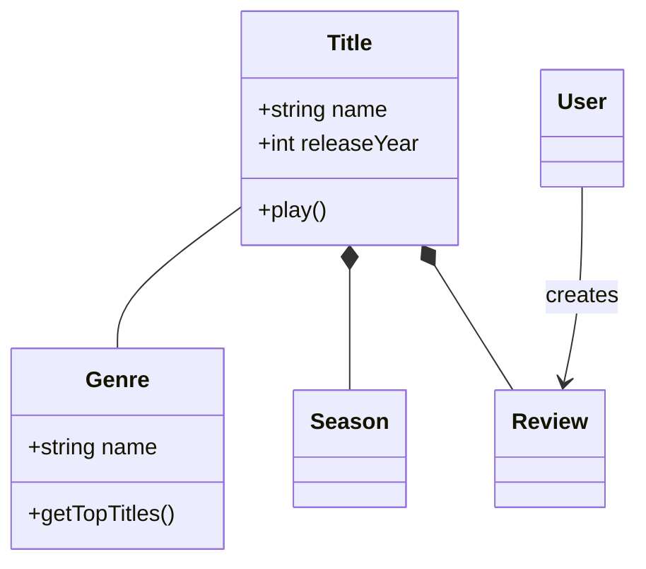
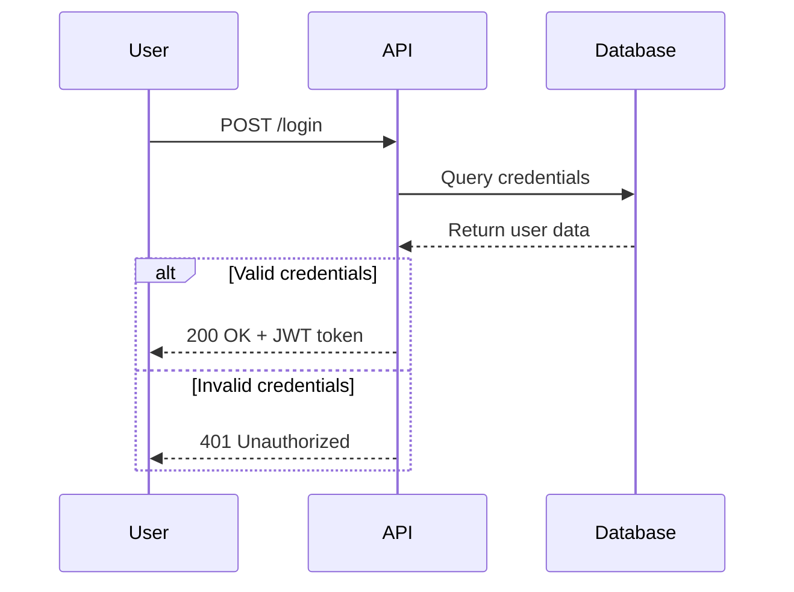
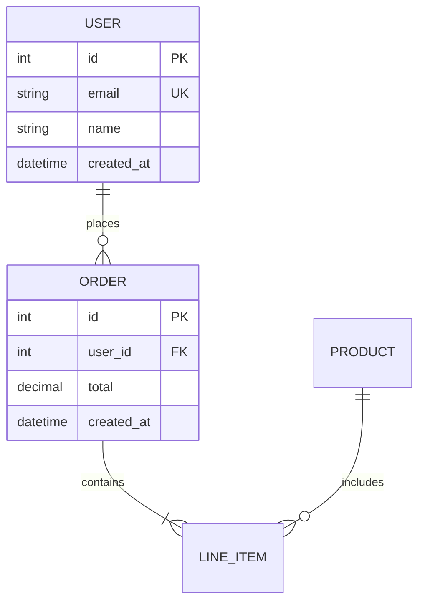
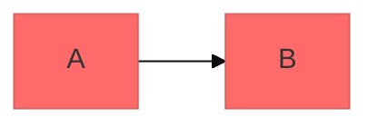

# Mermaid Diagramming

使用 Mermaid 的文本语法创建专业软件图表。Mermaid 从简单文本定义渲染图表，因此可以进行版本控制，易于更新，也能与代码一起维护。

## Core Syntax Structure

所有 Mermaid 图表均遵循以下形式：

```mermaid
diagramType
  definition content
```

**关键原则：**
- 首行声明图表类型（例如 `classDiagram`、`sequenceDiagram`、`flowchart`）
- 使用 `%%` 添加注释
- 换行和缩进提升可读性，但并非必需
- 无法识别的单词会导致图表出错；参数错误可能静默失败

## Diagram Type Selection Guide

**选择合适的图表类型：**

1. **Class Diagrams（类图）** -- 领域建模、OOP 设计、实体关系
   - 领域驱动设计文档
   - 面向对象类结构
   - 实体关系与依赖

2. **Sequence Diagrams（时序图）** -- 随时间发生的交互、消息流
   - API 请求与响应流程
   - 用户认证流程
   - 系统组件交互
   - 方法调用顺序

3. **Flowcharts（流程图）** -- 过程、算法、决策树
   - 用户旅程与工作流
   - 业务流程
   - 算法逻辑
   - 部署流水线

4. **Entity Relationship Diagrams（ERD，实体关系图）** -- 数据库 schema
   - 表关系
   - 数据建模
   - Schema 设计

5. **C4 Diagrams（C4 图）** -- 多层次软件架构
   - System Context（系统和用户）
   - Container（应用、数据库、服务）
   - Component（内部结构）
   - Code（类与接口层）

6. **State Diagrams（状态图）** -- 状态机、生命周期状态
7. **Git Graphs（Git 图）** -- 版本控制分支策略
8. **Gantt Charts（甘特图）** -- 项目时间线、排期
9. **Pie/Bar Charts（饼图与柱状图）** -- 数据可视化

## Quick Start Examples

### Class Diagram (Domain Model)


### Sequence Diagram (API Flow)


### Flowchart (User Journey)


### ERD (Database Schema)


## Detailed References

各图表类型的深入指导见：

- **[references/class-diagrams.md](references/class-diagrams.md)** -- 领域建模、关联/组合/聚合/继承、多重性、方法与属性
- **[references/sequence-diagrams.md](references/sequence-diagrams.md)** -- 角色、参与者、同步/异步消息、激活、循环、alt/opt/par 块、注释
- **[references/flowcharts.md](references/flowcharts.md)** -- 节点形状、连接、决策逻辑、子图、样式
- **[references/erd-diagrams.md](references/erd-diagrams.md)** -- 实体、关系、基数、键、属性
- **[references/c4-diagrams.md](references/c4-diagrams.md)** -- 系统上下文、容器、组件图、边界
- **[references/architecture-diagrams.md](references/architecture-diagrams.md)** -- 云服务、基础设施、CI/CD 部署
- **[references/advanced-features.md](references/advanced-features.md)** -- 主题、样式、配置、布局选项

## Best Practices

1. **从简单开始** -- 先画核心实体或组件，再逐步增加细节
2. **使用有意义的名称** -- 清楚的标签让图表自行说明含义
3. **充分注释** -- 用 `%%` 解释复杂关系
4. **保持聚焦** -- 每张图讲一个概念；将大图拆成多个聚焦视图
5. **版本控制** -- 将 `.mmd` 文件与代码放在一起，便于更新
6. **补充上下文** -- 用标题和注释说明图表目的
7. **持续迭代** -- 随理解加深，不断完善图表

## Configuration and Theming

通过 frontmatter 配置图表：



**可用主题：** default、forest、dark、neutral、base

**布局选项：**
- `layout: dagre`（默认）-- 经典均衡布局
- `layout: elk` -- 用于复杂图表的高级布局（需要集成）

**外观选项：**
- `look: classic` -- 传统 Mermaid 风格
- `look: handDrawn` -- 草图外观

## Exporting and Rendering

**原生支持：**
- GitHub/GitLab -- 在 Markdown 中自动渲染
- VS Code -- 使用 Markdown Mermaid 扩展
- Notion、Obsidian、Confluence -- 内置支持

**导出选项：**
- [Mermaid Live Editor](https://mermaid.live) -- 支持导出 PNG/SVG 的在线编辑器
- Mermaid CLI -- 先 `npm install -g @mermaid-js/mermaid-cli`，再 `mmdc -i input.mmd -o output.png`
- Docker -- `docker run --rm -v $(pwd):/data minlag/mermaid-cli -i /data/input.mmd -o /data/output.png`

## Common Pitfalls

- **易出问题的字符** -- 注释中避免 `{}`，特殊字符使用正确转义
- **语法错误** -- 拼写错误会导致图表失败；用 Mermaid Live 验证语法
- **过度复杂** -- 将复杂图表拆成多个聚焦视图
- **缺少关系** -- 记录实体之间所有重要连接

## When to Create Diagrams

**以下情形始终画图：**
- 启动新项目或功能
- 记录复杂系统
- 解释架构决策
- 设计数据库 schema
- 规划重构
- 帮助新成员熟悉系统

**使用图表来：**
- 让相关方就技术决策达成一致
- 协作记录领域模型
- 展示数据流与系统交互
- 编码前规划
- 创建随代码演进的活文档
