# Advanced Mermaid Features

用于创建专业图表的高级配置、样式、主题及其他功能。

## Frontmatter Configuration

在图表顶部添加 YAML 配置：

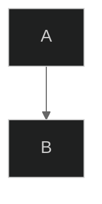

## Themes

### Built-in Themes

```mermaid
---
config:
  theme: default
---
```

**可用主题：**
- `default` -- 标准蓝色主题
- `forest` -- 绿色大地色调
- `dark` -- 适合深色模式
- `neutral` -- 专业灰度风格
- `base` -- 用于自定义的最小基础主题

### Theme Examples

**默认主题：**
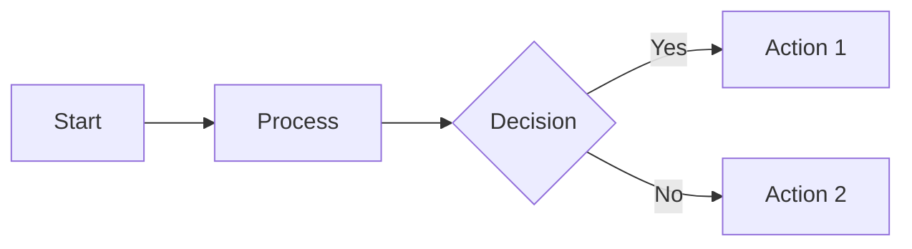

**深色主题：**
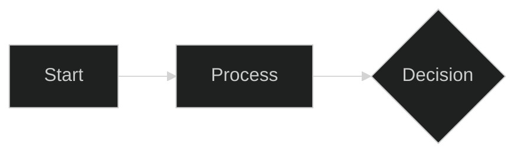

**森林主题：**
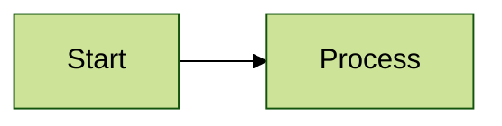

## Custom Theme Variables

覆盖特定颜色：

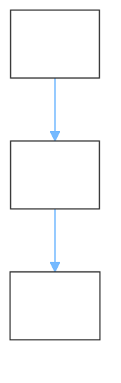

## Layout Options

### Dagre Layout (Default)

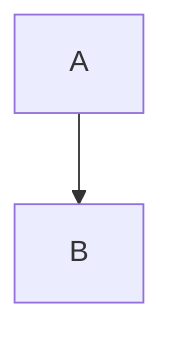

### ELK Layout (Advanced)

为复杂图表提供更好的自动布局：

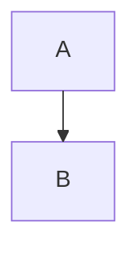

**ELK 节点放置策略：**
- `SIMPLE` -- 基础放置
- `NETWORK_SIMPLEX` -- 网络优化
- `LINEAR_SEGMENTS` -- 线性排列
- `BRANDES_KOEPF` -- 均衡（默认）

## Look Options

### Classic Look

传统 Mermaid 外观：

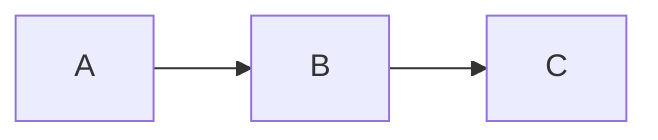

### Hand-Drawn Look

草图式、非正式风格：

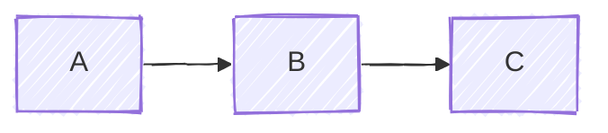

## Complete Configuration Example

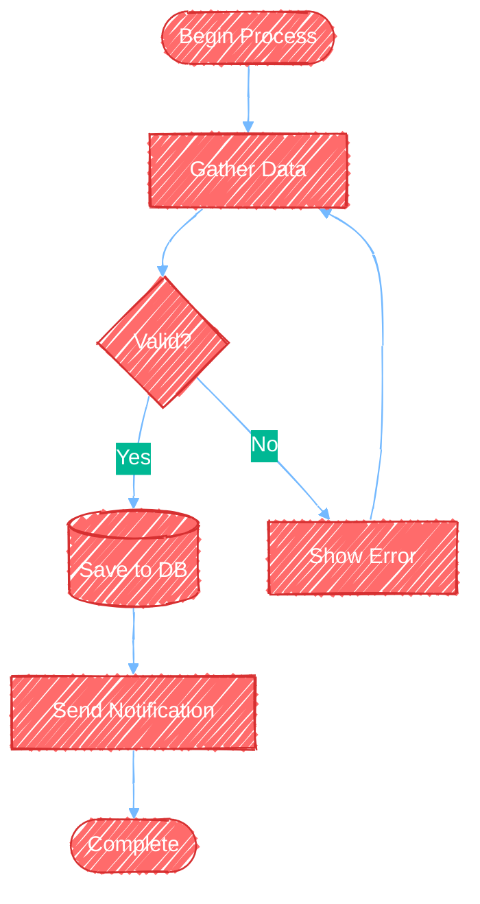

## Diagram-Specific Styling

### Flowchart Styling

**基于类的样式：**
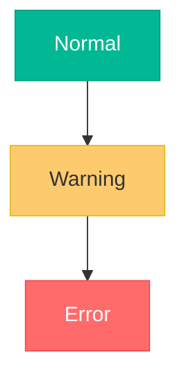

**特定节点样式：**
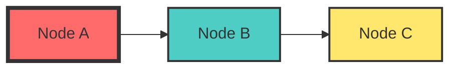

**连线样式：**
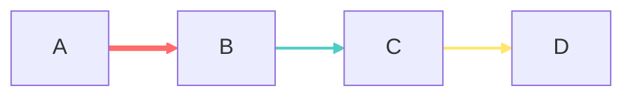

### Sequence Diagram Styling

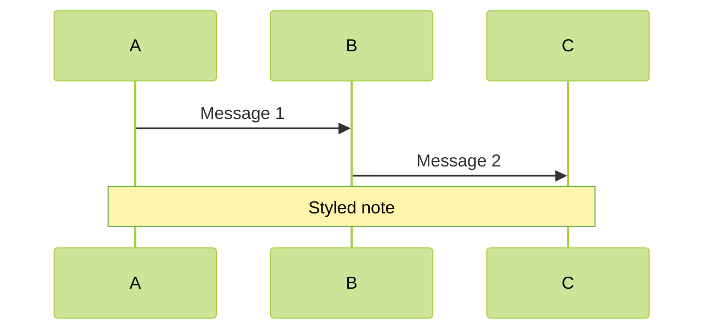

### Class Diagram Styling

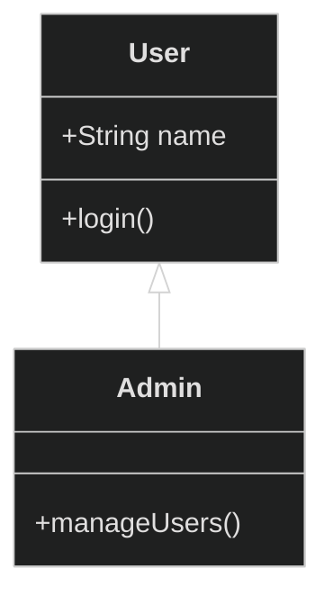

## Directional Hints

控制特定节点的布局方向：

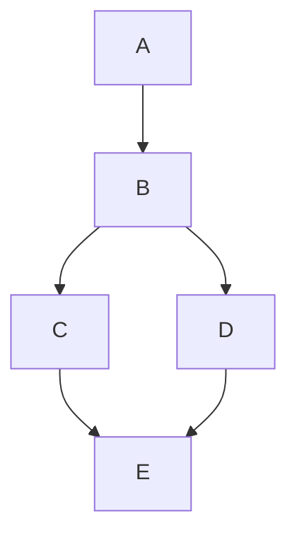

## Click Events and Links

添加交互元素：


## Tooltips

添加悬停信息：

```mermaid
flowchart LR
    A[Service A]
    B[Service B]
    
    A -.->|REST API| B
    
    %% Tooltips are defined with links
    link A: API Documentation @ https://api.example.com
    link B: Service Dashboard @ https://dashboard.example.com
```

## Subgraph Styling

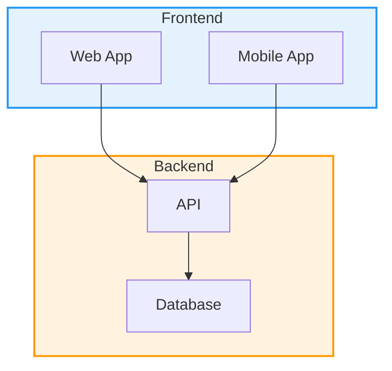

## Comments and Documentation

```mermaid
flowchart TD
    %% This is a single-line comment
    
    %% Multi-line comments can be created
    %% by using multiple comment lines
    
    A[Start]
    B[Process]
    C[End]
    
    %% Define relationships
    A --> B
    B --> C
    
    %% Add styling
    style A fill:#90EE90
    style C fill:#FFB6C1
```

## Complex Styling Example

```mermaid
flowchart TB
    subgraph production[Production Environment]
        direction LR
        lb[Load Balancer]
        
        subgraph servers[Application Servers]
            app1[Server 1]
            app2[Server 2]
            app3[Server 3]
        end
        
        cache[(Redis Cache)]
        db[(PostgreSQL)]
    end
    
    subgraph monitoring[Monitoring]
        logs[Log Aggregator]
        metrics[Metrics Dashboard]
    end
    
    users[Users] --> lb
    lb --> app1 & app2 & app3
    app1 & app2 & app3 --> cache
    app1 & app2 & app3 --> db
    app1 & app2 & app3 --> logs
    logs --> metrics
    
    style production fill:#e8f5e9,stroke:#4caf50,stroke-width:3px
    style servers fill:#fff3e0,stroke:#ff9800,stroke-width:2px
    style monitoring fill:#e3f2fd,stroke:#2196f3,stroke-width:2px
    
    style lb fill:#ffeb3b,stroke:#fbc02d,stroke-width:2px
    style cache fill:#ce93d8,stroke:#ab47bc,stroke-width:2px
    style db fill:#ce93d8,stroke:#ab47bc,stroke-width:2px
    
    classDef serverClass fill:#81c784,stroke:#4caf50,stroke-width:2px,color:#000
    class app1,app2,app3 serverClass
    
    linkStyle 0,1,2,3 stroke:#4caf50,stroke-width:2px
    linkStyle 4,5,6,7,8,9 stroke:#ff9800,stroke-width:1px
```

## Responsive Sizing

通过 CSS 让图表响应式适配：

```html
<div style="max-width: 100%; overflow: auto;">
    <pre class="mermaid">
        flowchart LR
            A --> B --> C
    </pre>
</div>
```

## SVG Export Options

导出 SVG 时：

```bash
# Export with custom dimensions
mmdc -i diagram.mmd -o output.svg -w 1920 -H 1080

# Export with background color
mmdc -i diagram.mmd -o output.svg -b "#ffffff"

# Export with transparent background
mmdc -i diagram.mmd -o output.svg -b "transparent"
```

## Best Practices for Advanced Features

1. **统一使用主题** -- 相关图表选择同一主题
2. **不要过度美化** -- 颜色太多会降低清晰度
3. **测试手绘外观** -- 有些图表更适合经典外观
4. **复杂布局使用 ELK** -- 尤其 dagre 出现交叉线时
5. **注释复杂配置** -- 解释不明显的样式选择
6. **保持无障碍** -- 确保颜色对比充足
7. **测试导出** -- 验证目标格式中渲染正确
8. **配置纳入版本控制** -- 在仓库中跟踪主题变更

## Accessibility Considerations

```mermaid
---
config:
  theme: base
  themeVariables:
    primaryColor: "#0066cc"
    primaryTextColor: "#ffffff"
    primaryBorderColor: "#003d7a"
    lineColor: "#333333"
    background: "#ffffff"
    mainBkg: "#f0f0f0"
---
flowchart TD
    A[High Contrast Text] --> B[Clear Labels]
    B --> C[Meaningful Colors]
```

**无障碍提示：**
- 使用高对比度配色
- 不要只靠颜色传达含义
- 加入说明性文字标签
- 用色盲模拟器测试
- 考虑深色模式替代方案

## Performance Considerations

对于大型图表：

```mermaid
---
config:
  layout: elk
  elk:
    mergeEdges: true
---
flowchart TD
    %% ELK handles complex layouts better
    %% Merge edges reduces visual clutter
```

**性能提示：**
- 超过 20 个节点的图使用 ELK 布局
- 启用边合并，简化连接
- 将非常大的图拆成多个聚焦视图
- 考虑使用子图组织复杂内容
- 样式只用于必要元素

## Integration Examples

### Markdown Files

````markdown
# System Architecture

```mermaid
flowchart LR
    A --> B
```
````

### HTML Files

```html
<!DOCTYPE html>
<html>
<head>
    <script type="module">
        import mermaid from 'https://cdn.jsdelivr.net/npm/mermaid@10/dist/mermaid.esm.min.mjs';
        mermaid.initialize({ 
            startOnLoad: true,
            theme: 'dark',
            look: 'handDrawn'
        });
    </script>
</head>
<body>
    <pre class="mermaid">
        flowchart LR
            A --> B
    </pre>
</body>
</html>
```

### React Components

```jsx
import React from 'react';
import mermaid from 'mermaid';

mermaid.initialize({
    startOnLoad: true,
    theme: 'forest'
});

function DiagramComponent() {
    React.useEffect(() => {
        mermaid.contentLoaded();
    }, []);
    
    return (
        <div className="mermaid">
            flowchart LR
                A --> B
        </div>
    );
}
```
