# Advanced Mermaid Features

用于创建专业 diagrams 的高级 configuration、styling、theming，以及其他强大 features。

## Frontmatter Configuration

在 diagrams 顶部添加 YAML configuration：

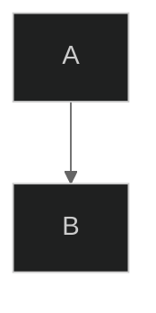

## Themes

### Built-in Themes

```mermaid
---
config:
  theme: default
---
```

**可用 themes：**
- `default` - 标准蓝色 theme
- `forest` - 绿色 earth tones
- `dark` - 适合 dark mode
- `neutral` - 专业的 grayscale 风格
- `base` - 用于自定义的极简 base theme

### Theme Examples

**默认 Theme：**
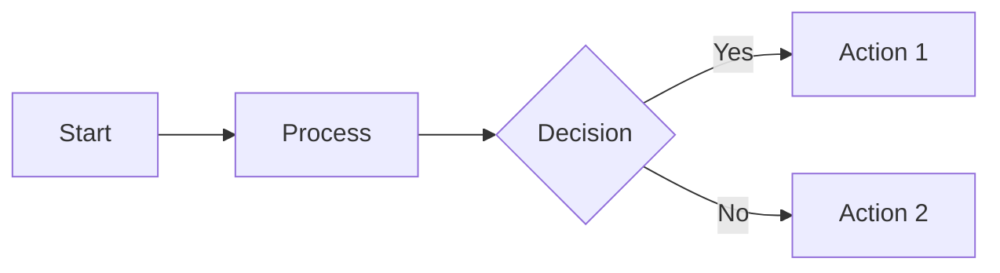

**Dark Theme：**
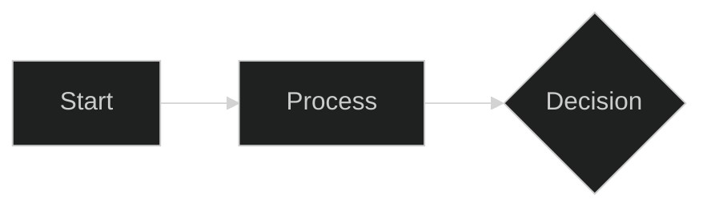

**Forest Theme：**
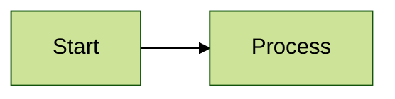

## Custom Theme Variables

覆盖特定颜色：

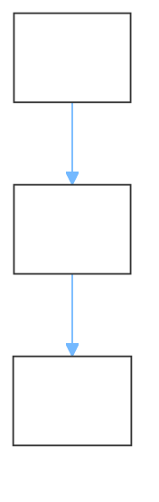

## Layout Options

### Dagre Layout (Default)

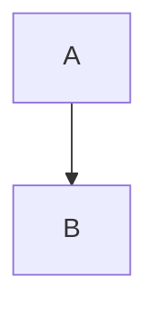

### ELK Layout (Advanced)

为复杂 diagrams 提供更好的 automatic layout：

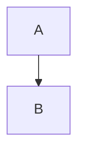

**ELK node placement strategies：**
- `SIMPLE` - 基础 placement
- `NETWORK_SIMPLEX` - Network optimization
- `LINEAR_SEGMENTS` - Linear arrangement
- `BRANDES_KOEPF` - 均衡（默认）

## Look Options

### Classic Look

传统的 Mermaid 外观：

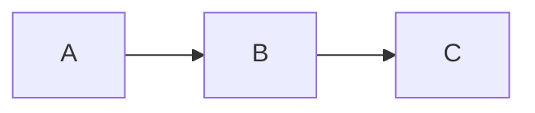

### Hand-Drawn Look

类似草图的非正式 style：

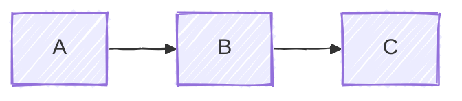

## Complete Configuration Example

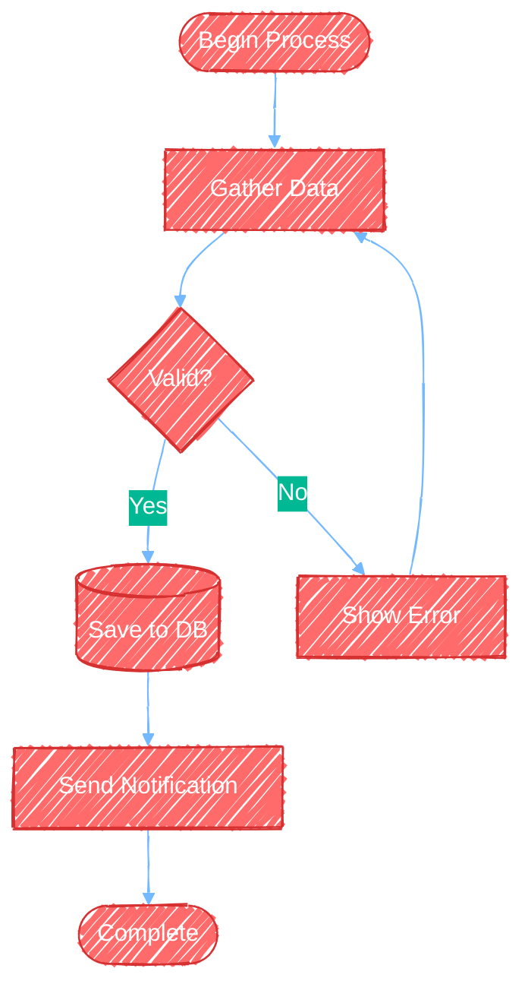

## Diagram-Specific Styling

### Flowchart Styling

**基于 class 的 styling：**
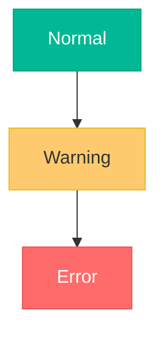

**特定 node 的 styling：**
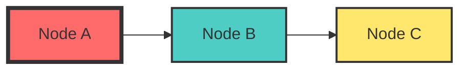

**Link styling：**
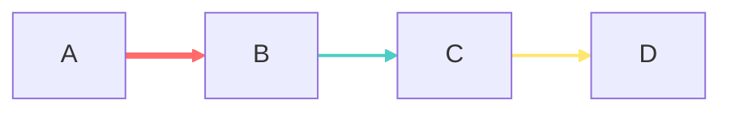

### Sequence Diagram Styling

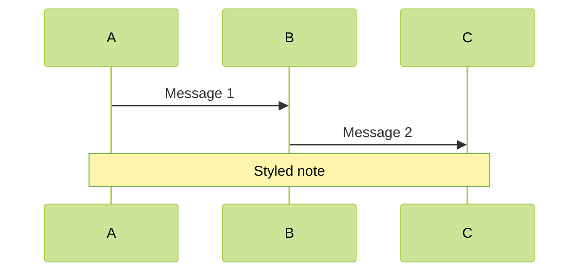

### Class Diagram Styling

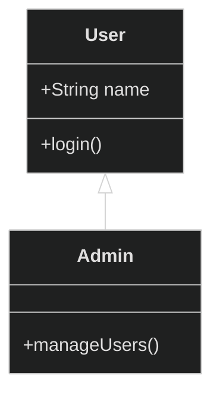

## Directional Hints

控制特定 nodes 的 layout direction：

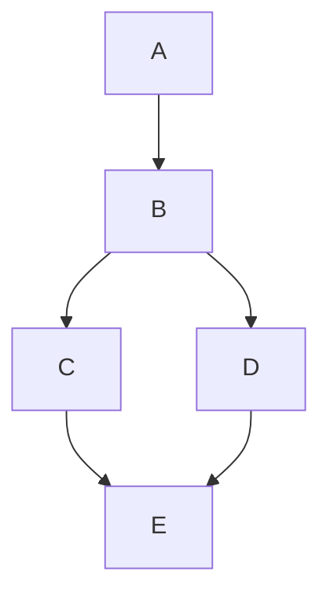

## Click Events and Links

添加 interactive elements：


## Tooltips

添加 hover information：

```mermaid
flowchart LR
    A[Service A]
    B[Service B]
    
    A -.->|REST API| B
    
    %% Tooltips are defined with links
    link A: API Documentation @ https://api.example.com
    link B: Service Dashboard @ https://dashboard.example.com
```

## Subgraph Styling

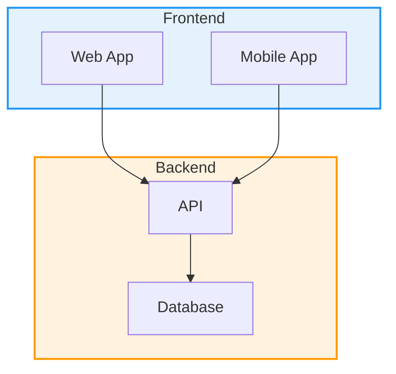

## Comments and Documentation

```mermaid
flowchart TD
    %% This is a single-line comment
    
    %% Multi-line comments can be created
    %% by using multiple comment lines
    
    A[Start]
    B[Process]
    C[End]
    
    %% Define relationships
    A --> B
    B --> C
    
    %% Add styling
    style A fill:#90EE90
    style C fill:#FFB6C1
```

## Complex Styling Example

```mermaid
flowchart TB
    subgraph production[Production Environment]
        direction LR
        lb[Load Balancer]
        
        subgraph servers[Application Servers]
            app1[Server 1]
            app2[Server 2]
            app3[Server 3]
        end
        
        cache[(Redis Cache)]
        db[(PostgreSQL)]
    end
    
    subgraph monitoring[Monitoring]
        logs[Log Aggregator]
        metrics[Metrics Dashboard]
    end
    
    users[Users] --> lb
    lb --> app1 & app2 & app3
    app1 & app2 & app3 --> cache
    app1 & app2 & app3 --> db
    app1 & app2 & app3 --> logs
    logs --> metrics
    
    style production fill:#e8f5e9,stroke:#4caf50,stroke-width:3px
    style servers fill:#fff3e0,stroke:#ff9800,stroke-width:2px
    style monitoring fill:#e3f2fd,stroke:#2196f3,stroke-width:2px
    
    style lb fill:#ffeb3b,stroke:#fbc02d,stroke-width:2px
    style cache fill:#ce93d8,stroke:#ab47bc,stroke-width:2px
    style db fill:#ce93d8,stroke:#ab47bc,stroke-width:2px
    
    classDef serverClass fill:#81c784,stroke:#4caf50,stroke-width:2px,color:#000
    class app1,app2,app3 serverClass
    
    linkStyle 0,1,2,3 stroke:#4caf50,stroke-width:2px
    linkStyle 4,5,6,7,8,9 stroke:#ff9800,stroke-width:1px
```

## Responsive Sizing

使用 CSS 使 diagrams 具有 responsive 特性：

```html
<div style="max-width: 100%; overflow: auto;">
    <pre class="mermaid">
        flowchart LR
            A --> B --> C
    </pre>
</div>
```

## SVG Export Options

导出 SVG 时：

```bash
# Export with custom dimensions
mmdc -i diagram.mmd -o output.svg -w 1920 -H 1080

# Export with background color
mmdc -i diagram.mmd -o output.svg -b "#ffffff"

# Export with transparent background
mmdc -i diagram.mmd -o output.svg -b "transparent"
```

## Best Practices for Advanced Features

1. **一致地使用 themes** - 为相关 diagrams 选择同一个 theme
2. **不要过度设置 style** - 过多 colors 可能降低清晰度
3. **测试 hand-drawn look** - 有些 diagrams 使用 classic look 效果更好
4. **对复杂 layouts 使用 ELK** - 当 dagre 产生 crossed lines 时
5. **为复杂 configurations 编写 comments** - 解释不明显的 styling choices
6. **保持 accessible** - 确保足够的 color contrast
7. **测试 exports** - 验证 diagrams 在目标格式中正确渲染
8. **对 configs 进行 version control** - 在 repository 中跟踪 theme changes

## Accessibility Considerations

```mermaid
---
config:
  theme: base
  themeVariables:
    primaryColor: "#0066cc"
    primaryTextColor: "#ffffff"
    primaryBorderColor: "#003d7a"
    lineColor: "#333333"
    background: "#ffffff"
    mainBkg: "#f0f0f0"
---
flowchart TD
    A[High Contrast Text] --> B[Clear Labels]
    B --> C[Meaningful Colors]
```

**Accessibility 提示：**
- 使用 high contrast 配色
- 不要仅靠 color 传达含义
- 包含描述性 text labels
- 使用 color blindness simulators 测试
- 考虑 dark mode 替代方案

## Performance Considerations

对于大型图表：

```mermaid
---
config:
  layout: elk
  elk:
    mergeEdges: true
---
flowchart TD
    %% ELK handles complex layouts better
    %% Merge edges reduces visual clutter
```

**Performance 提示：**
- 对 nodes 数量大于 20 的 diagrams 使用 ELK layout
- 启用 edge merging，以简化 connections
- 将非常大的 diagrams 拆成多个聚焦的 views
- 考虑使用 subgraphs 组织复杂内容
- 将 styling 限制在必要的 elements 上

## Integration Examples

### Markdown Files

````markdown
# System Architecture

```mermaid
flowchart LR
    A --> B
```
````

### HTML Files

```html
<!DOCTYPE html>
<html>
<head>
    <script type="module">
        import mermaid from 'https://cdn.jsdelivr.net/npm/mermaid@10/dist/mermaid.esm.min.mjs';
        mermaid.initialize({ 
            startOnLoad: true,
            theme: 'dark',
            look: 'handDrawn'
        });
    </script>
</head>
<body>
    <pre class="mermaid">
        flowchart LR
            A --> B
    </pre>
</body>
</html>
```

### React Components

```jsx
import React from 'react';
import mermaid from 'mermaid';

mermaid.initialize({
    startOnLoad: true,
    theme: 'forest'
});

function DiagramComponent() {
    React.useEffect(() => {
        mermaid.contentLoaded();
    }, []);
    
    return (
        <div className="mermaid">
            flowchart LR
                A --> B
        </div>
    );
}
```
