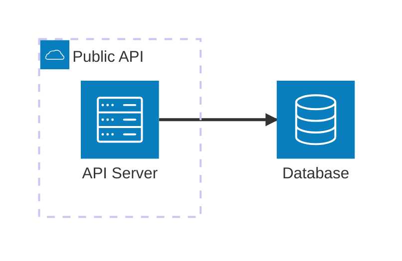
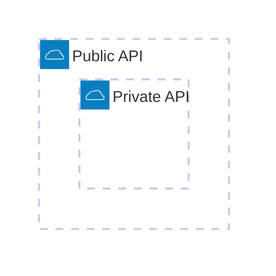
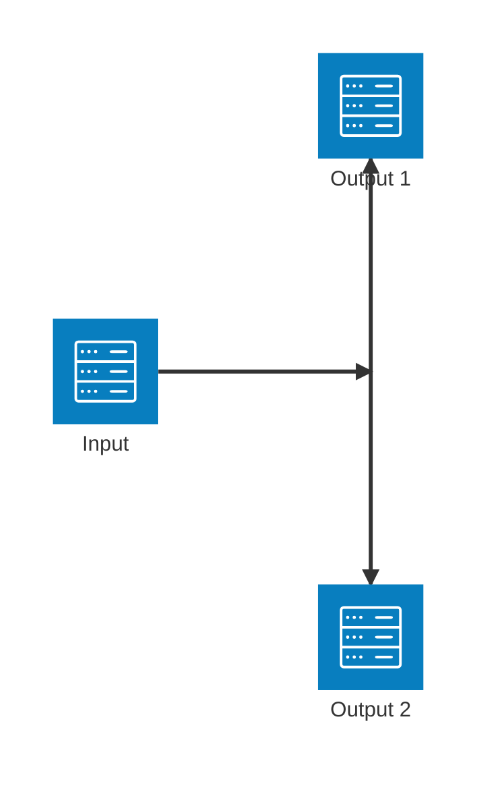

```mermaid
architecture-beta
    service web(logos:docker)[Docker Container]
    service k8s(logos:kubernetes)[Kubernetes Cluster]
    service aws(logos:aws)[AWS Services]
    service github(logos:github)[GitHub Actions]

    web:R --> L:k8s
    k8s:R --> L:aws
    web:R --> L:github
```

# Architecture Diagrams Reference

Architecture diagrams 可视化 cloud services、CI/CD deployments 和 infrastructure relationships。在 Mermaid v11.1.0 中引入。

## Basic Syntax



## Building Blocks

### Groups

将相关 services 归在一起：

```
group {groupId}({icon})[{title}] (in {parentId})?
```



### Services

声明 services（nodes）：

```
service {serviceId}({icon})[{title}] (in {parentId})?
```

```mermaid
architecture-beta
    service api(server)[API Server]
    service db(database)[Database]
    service cache(redis)[Cache] in api
```

### Edges

使用 edges 连接 services：

```
{serviceId}{{group}}?:{T|B|L|R} {<}?--{>}? {T|B|L|R}:{serviceId}{{group}}?
```

**方向：** `T`（上）、`B`（下）、`L`（左）、`R`（右）

**Arrows：** `<` 表示 incoming，`>` 表示 outgoing

```mermaid
architecture-beta
    service client(browser)[Client]
    service api(server)[API]
    service db(database)[Database]

    client:B --> T:api
    api:R --> L:db
```



### Junctions

创建 4-way splits：

```
junction {junctionId} (in {parentId})?
```



## Icons

**默认 icons：** `cloud`、`database`、`disk`、`internet`、`server`

**自定义 icons：** 从 iconify.design 提供的 200,000 多个 icons 中任意选用：

```mermaid
architecture-beta
    service web(aws:ec2)[Web Server]
    service storage(aws:s3)[Storage]
```



### Using @iconify-json Icon Packs

将 npm icon packs 与 Mermaid CLI 配合使用，获得种类丰富的 technology logos：

```bash
npm install @iconify-json/logos @mermaid-js/mermaid-cli
mmdc --iconPacks @iconify-json/logos -i ./diagram.mmd -o ./output.svg
```

使用带 `logos:` prefix 的 icons：



**流行的 icon packs：**

| Icon Pack                    | 说明                                   | 安装                            |
| ---------------------------- | --------------------------------------------- | ---------------------------------- |
| `@iconify-json/logos`        | 技术品牌（Docker、AWS、GitHub 等） | `npm i @iconify-json/logos`        |
| `@iconify-json/bi`           | Bootstrap icons                               | `npm i @iconify-json/bi`           |
| `@iconify-json/mdi`          | Material Design icons                         | `npm i @iconify-json/mdi`          |
| `@iconify-json/simple-icons` | Simple icons                                  | `npm i @iconify-json/simple-icons` |

用法：`pack:icon-name`（例如 `logos:docker`、`mdi:database`）

## Complex Example

```mermaid
architecture-beta
    group internet(cloud)[Internet]
    group private_vpc(cloud)[Private VPC]

    service lb(load_balancer)[Load Balancer] in internet
    service api1(api)[API Server 1] in private_vpc
    service api2(api)[API Server 2] in private_vpc
    service db(database)[Primary Database] in private_vpc
    service replica(database)[Read Replica] in private_vpc

    lb:R --> L:api1
    lb:R --> L:api2
    api1:R --> L:db
    api2:R --> L:db
    db:R --> L:replica
```



## Edge Patterns

| Pattern              | 说明               |
| -------------------- | ------------------------- |
| `A:R -- L:B`         | Horizontal edge           |
| `A:T -- B:B`         | Vertical edge（90 度） |
| `A:R --> L:B`        | 带 arrow 的 edge           |
| `A:R <--> L:B`       | Bidirectional edge        |
| `A{group}:R --> L:B` | 从 group boundary 出发的 edge  |

## Group Edges

使用 `{group}` modifier 连接 groups：

```mermaid
architecture-beta
    group frontend(cloud)[Frontend]
    group backend(cloud)[Backend]

    service client(browser)[Client] in frontend
    service api(server)[API] in backend

    client{group}:B --> T:api{group}
```



## Best Practices

1. 按 environment（public/private）或 layer（frontend/backend）将 services 分组
2. 为 service types 使用一致的 icons
3. 为 edges 标注 protocols（HTTPS、TCP 等）
4. 使用 junctions 表达 fan-out patterns
5. 保持 diagrams 聚焦；将复杂 architectures 拆成多个 views

## Reference

- [官方文档](https://mermaid.js.org/syntax/architecture.html)
- [Iconify Icons](https://iconify.design)
