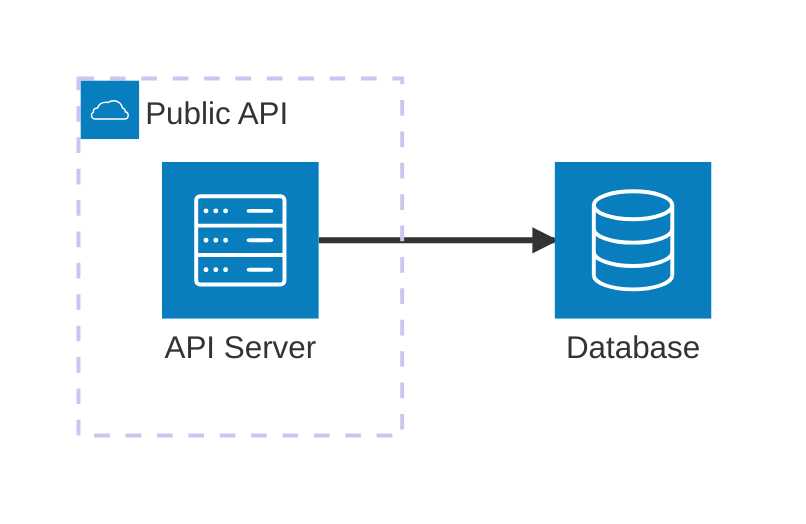
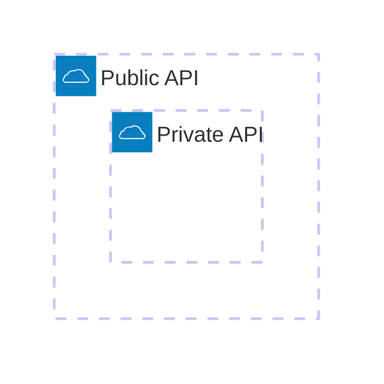
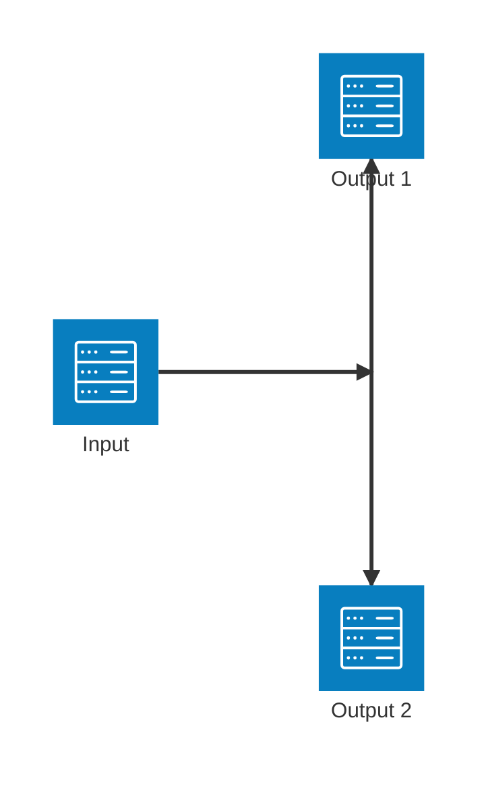

# Architecture Diagrams Reference

架构图可视化云服务、CI/CD 部署和基础设施关系。该类型于 Mermaid v11.1.0 引入。

## Basic Syntax



## Building Blocks

### Groups

将相关服务归组：

```
group {groupId}({icon})[{title}] (in {parentId})?
```



### Services

声明服务（节点）：

```
service {serviceId}({icon})[{title}] (in {parentId})?
```

```mermaid
architecture-beta
    service api(server)[API Server]
    service db(database)[Database]
    service cache(redis)[Cache] in api
```

### Edges

用边连接服务：

```
{serviceId}{{group}}?:{T|B|L|R} {<}?--{>}? {T|B|L|R}:{serviceId}{{group}}?
```

**方向：** `T`（上）、`B`（下）、`L`（左）、`R`（右）

**箭头：** `<` 表示入向，`>` 表示出向



```mermaid
architecture-beta
    service client(browser)[Client]
    service api(server)[API]
    service db(database)[Database]

    client:B --> T:api
    api:R --> L:db
```

### Junctions

创建四向分支：

```
junction {junctionId} (in {parentId})?
```



## Icons

**默认图标：** `cloud`、`database`、`disk`、`internet`、`server`

**自定义图标：** 可使用 iconify.design 的 200,000 多个图标：



```mermaid
architecture-beta
    service web(aws:ec2)[Web Server]
    service storage(aws:s3)[Storage]
```

### Using @iconify-json Icon Packs

配合 Mermaid CLI 使用 npm 图标包，获得各种技术标志：

```bash
npm install @iconify-json/logos @mermaid-js/mermaid-cli
mmdc --iconPacks @iconify-json/logos -i ./diagram.mmd -o ./output.svg
```

使用 `logos:` 前缀引用图标：

```mermaid
architecture-beta
    service web(logos:docker)[Docker Container]
    service k8s(logos:kubernetes)[Kubernetes Cluster]
    service aws(logos:aws)[AWS Services]
    service github(logos:github)[GitHub Actions]

    web:R --> L:k8s
    k8s:R --> L:aws
    web:R --> L:github
```



**常用图标包：**

| 图标包 | 说明 | 安装 |
| ---------------------------- | --------------------------------------------- | ---------------------------------- |
| `@iconify-json/logos` | 技术品牌（Docker、AWS、GitHub 等） | `npm i @iconify-json/logos` |
| `@iconify-json/bi` | Bootstrap 图标 | `npm i @iconify-json/bi` |
| `@iconify-json/mdi` | Material Design 图标 | `npm i @iconify-json/mdi` |
| `@iconify-json/simple-icons` | Simple Icons 图标 | `npm i @iconify-json/simple-icons` |

用法：`pack:icon-name`（例如 `logos:docker`、`mdi:database`）

## Complex Example

```mermaid
architecture-beta
    group internet(cloud)[Internet]
    group private_vpc(cloud)[Private VPC]

    service lb(load_balancer)[Load Balancer] in internet
    service api1(api)[API Server 1] in private_vpc
    service api2(api)[API Server 2] in private_vpc
    service db(database)[Primary Database] in private_vpc
    service replica(database)[Read Replica] in private_vpc

    lb:R --> L:api1
    lb:R --> L:api2
    api1:R --> L:db
    api2:R --> L:db
    db:R --> L:replica
```



## Edge Patterns

| 模式 | 说明 |
| -------------------- | ------------------------- |
| `A:R -- L:B` | 水平边 |
| `A:T -- B:B` | 垂直边（90 度） |
| `A:R --> L:B` | 带箭头的边 |
| `A:R <--> L:B` | 双向边 |
| `A{group}:R --> L:B` | 从分组边界出发的边 |

## Group Edges

使用 `{group}` 修饰符连接分组：



```mermaid
architecture-beta
    group frontend(cloud)[Frontend]
    group backend(cloud)[Backend]

    service client(browser)[Client] in frontend
    service api(server)[API] in backend

    client{group}:B --> T:api{group}
```

## Best Practices

1. 按环境（公开/私有）或层（前端/后端）归组服务
2. 同类服务使用一致的图标
3. 在边上标注协议（HTTPS、TCP 等）
4. 使用 junction 表达扇出模式
5. 保持聚焦，将复杂架构拆成多个视图

## Reference

- [官方文档](https://mermaid.js.org/syntax/architecture.html)
- [Iconify 图标](https://iconify.design)
