# Class Diagrams

类图用于表示面向对象设计与领域模型，展示实体（类）、属性与方法，以及彼此关系。

## Basic Syntax

```mermaid
classDiagram
    ClassName
```

## Defining Classes with Members

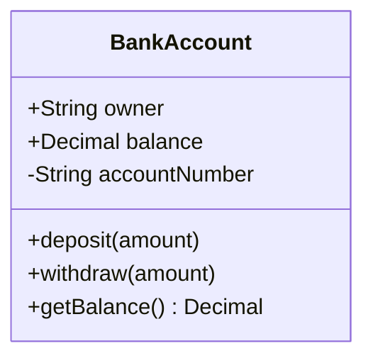

**可见性修饰符：**
- `+` 公开
- `-` 私有
- `#` 受保护
- `~` 包级或内部

**成员语法：**
- `+type attribute` -- 带类型的属性
- `+method(params) ReturnType` -- 带参数和返回类型的方法

## Relationships

### Association (`--`)
松散关系：实体相互使用，但独立存在。

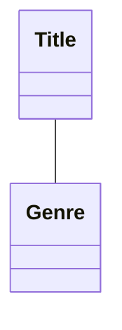

### Composition (`*--`)
强所有权：子对象不能脱离父对象存在；删除父对象时，也删除子对象。

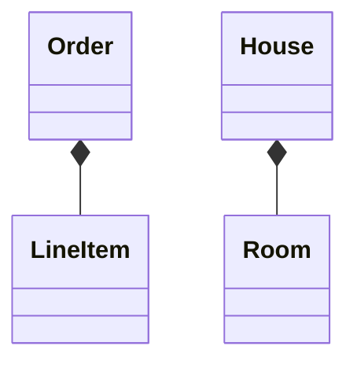

### Aggregation (`o--`)
较弱的所有权：子对象可以独立存在，表示“has-a”关系。

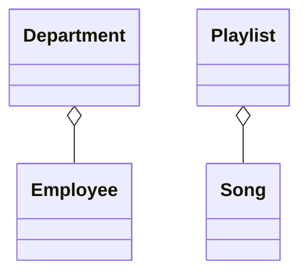

### Inheritance (`<|--`)
“Is-a”关系：子类继承父类。

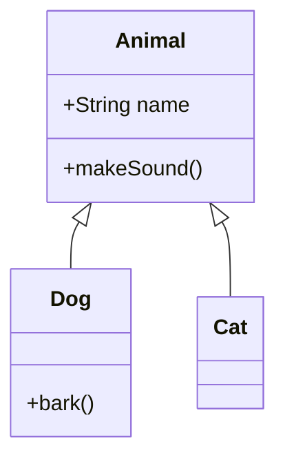

### Dependency (`<..`)
一个类依赖另一个类，常通过参数或局部变量体现。

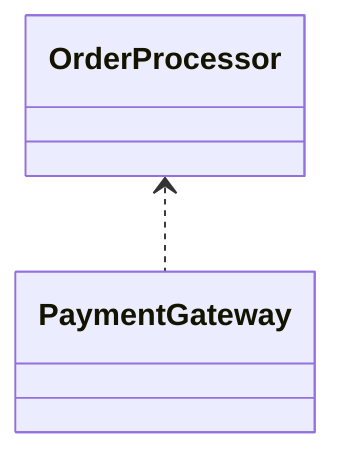

### Realization/Implementation (`<|..`)
类实现某个接口。

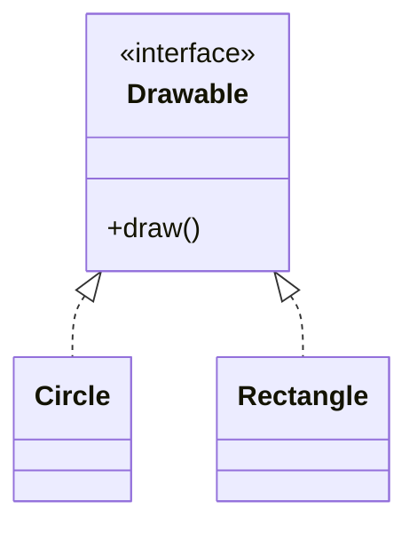

## Multiplicity

表示参与关系的实例数量：

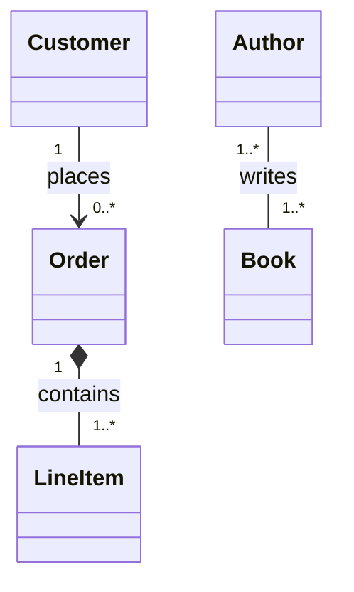

**常见多重性：**
- `1` -- 恰好一个
- `0..1` -- 零个或一个
- `0..*` 或 `*` -- 零个或多个
- `1..*` -- 一个或多个
- `m..n` -- m 到 n 个

## Relationship Labels

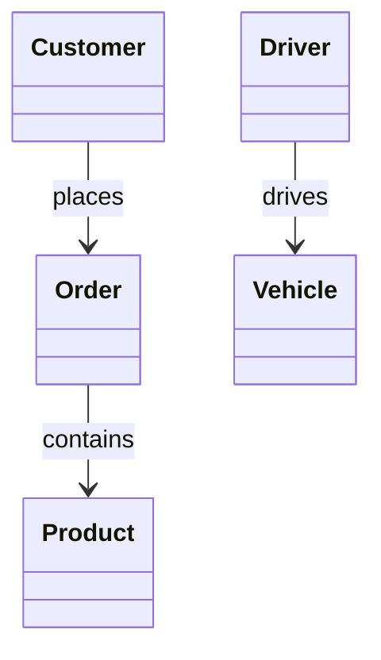

## Class Stereotypes

标记特殊的类类型：

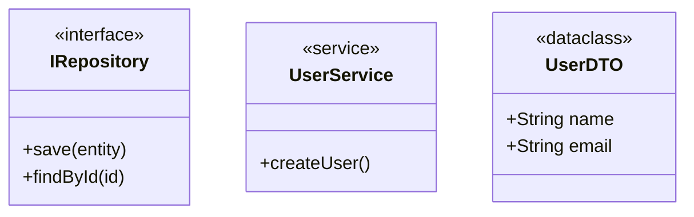

## Abstract Classes and Methods

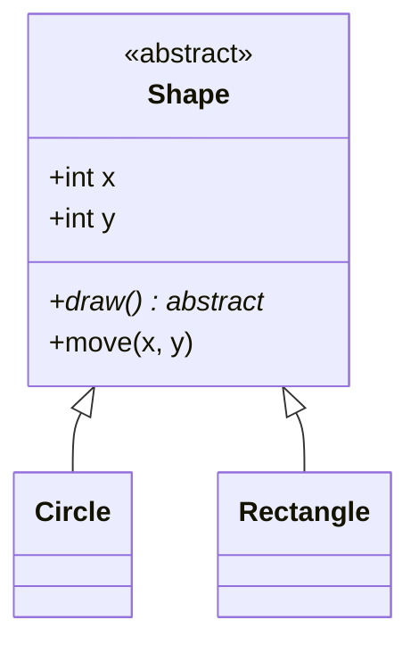

## Generic Classes

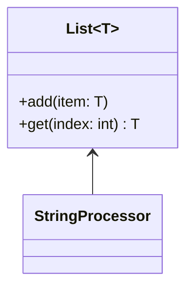

## Comprehensive Example: E-Commerce Domain

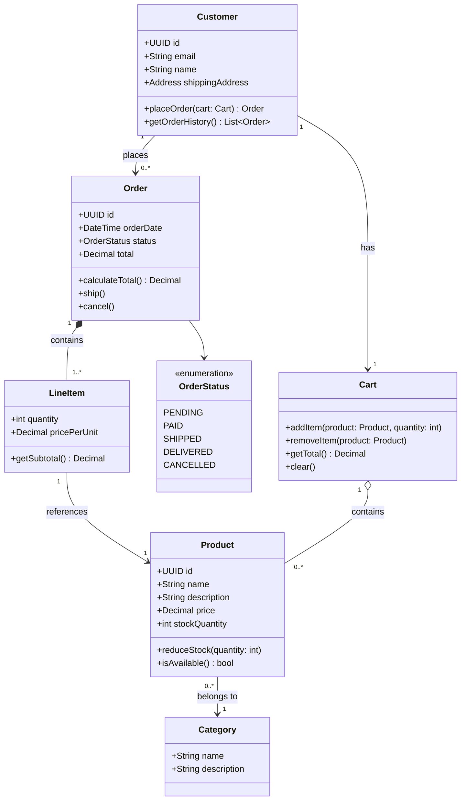

## Domain-Driven Design Patterns

### Entities
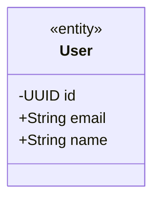

### Value Objects
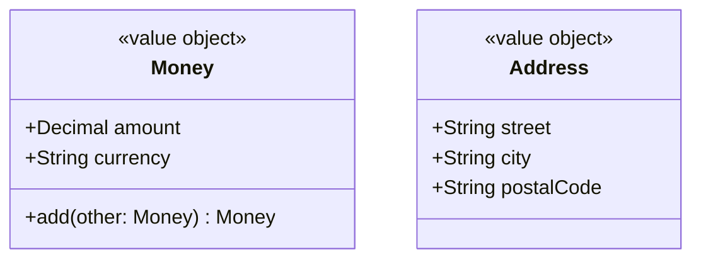

### Aggregates
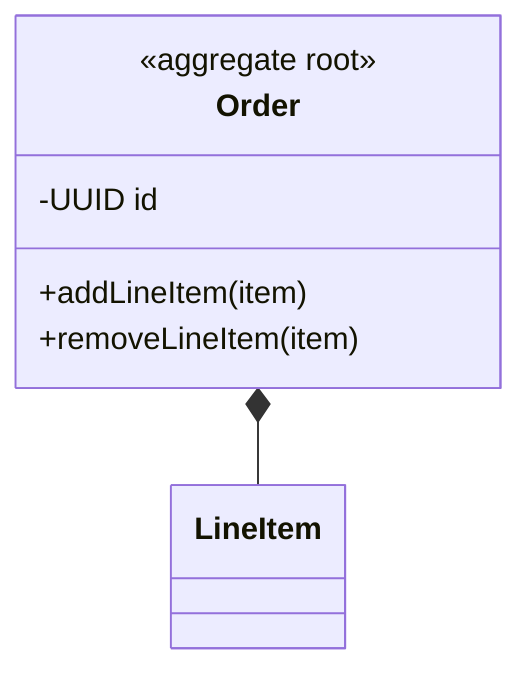

## Tips for Effective Class Diagrams

1. **从核心实体开始** -- 逐步添加属性和方法
2. **只展示相关细节** -- 非必要时省略显而易见的 getter/setter
3. **选择适当关系** -- 仔细区分关联、聚合与组合
4. **添加多重性** -- 明确参与关系的实例数量
5. **归组相关类** -- 使用注释或视觉上的接近关系
6. **记录不变量** -- 用注释解释业务规则

## Common Patterns

### Repository Pattern
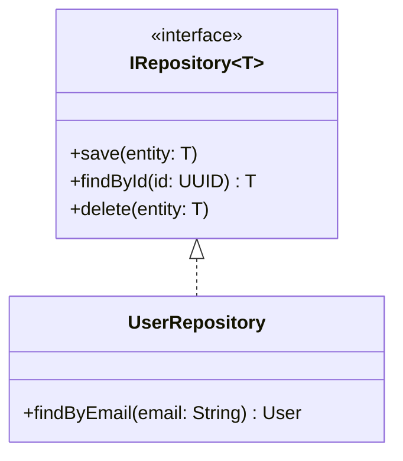

### Factory Pattern
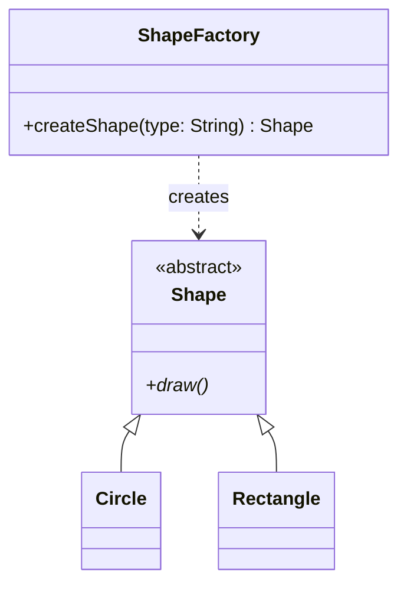

### Strategy Pattern
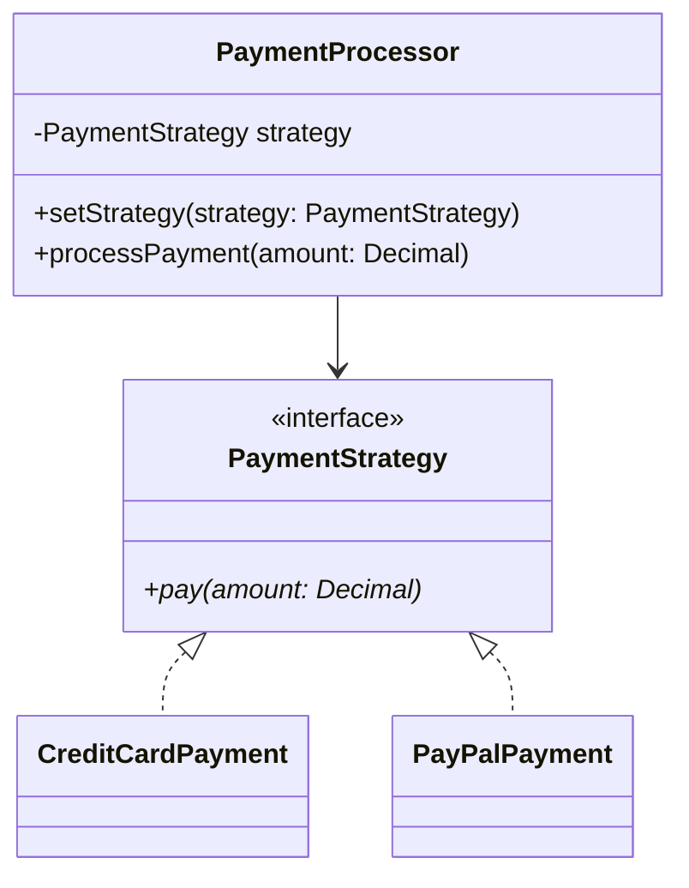
