# Class Diagrams

Class diagrams 为 object-oriented designs 和 domain models 建模。它们展示 entities（classes）、它们的 attributes/methods 以及 relationships。

## Basic Syntax

```mermaid
classDiagram
    ClassName
```

## Defining Classes with Members

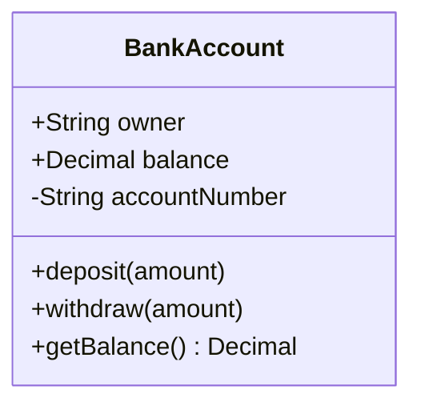

**Visibility modifiers:**
- `+` Public
- `-` Private
- `#` Protected
- `~` Package/Internal

**Member syntax:**
- `+type attribute` - 带 type 的 attribute
- `+method(params) ReturnType` - 带 parameters 和 return type 的 method

## Relationships

### Association (`--`)
一种松散的 relationship，其中 entities 相互使用，但独立存在。

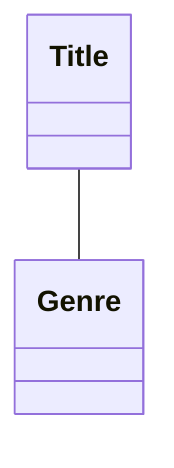

### Composition (`*--`)
强 ownership - child 不能脱离 parent 存在。删除 parent 时，children 也会被删除。

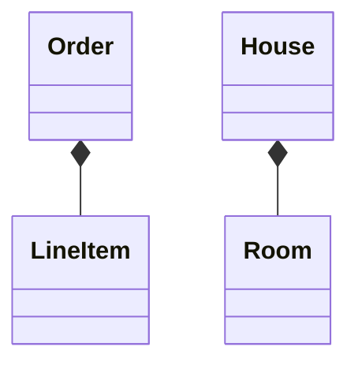

### Aggregation (`o--`)
较弱的 ownership - child 可以独立存在。表示 "has-a" relationship。

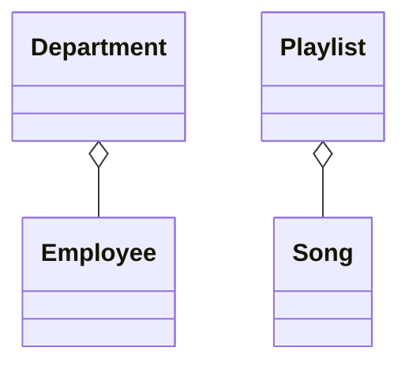

### Inheritance (`<|--`)
"Is-a" relationship。Child class 继承自 parent class。

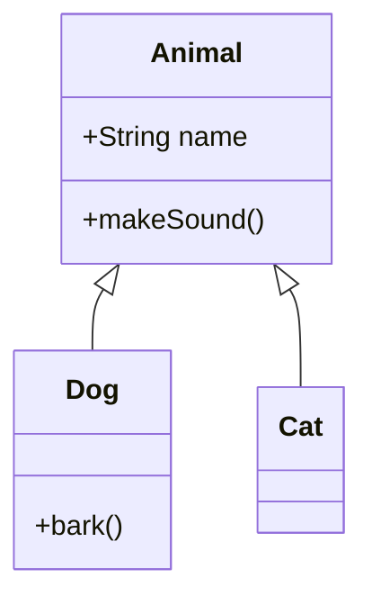

### Dependency (`<..`)
一个 class 依赖另一个 class，通常体现为 parameter 或 local variable。

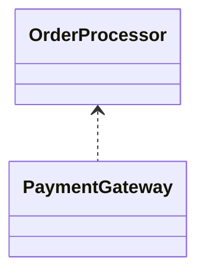

### Realization/Implementation (`<|..`)
Class 实现一个 interface。

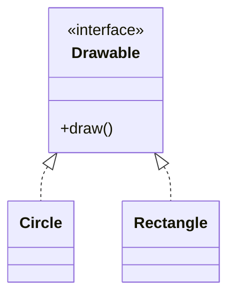

## Multiplicity

展示参与某个 relationship 的 instances 数量：

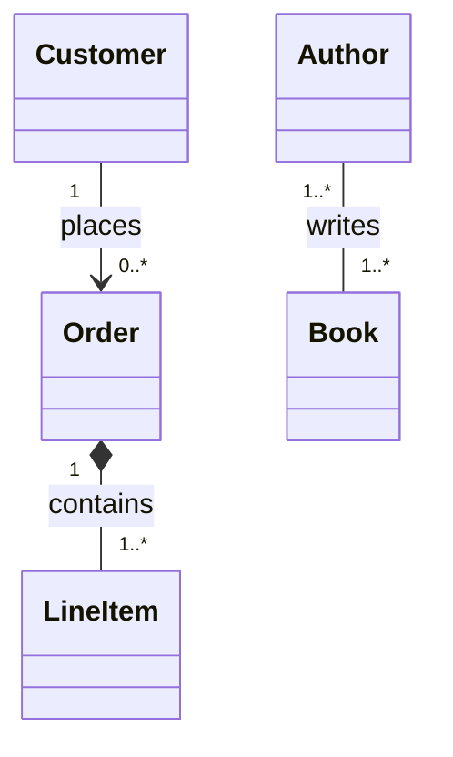

**常见 multiplicities：**
- `1` - 恰好一个
- `0..1` - 零个或一个
- `0..*` 或 `*` - 零个或多个
- `1..*` - 一个或多个
- `m..n` - m 到 n 个

## Relationship Labels

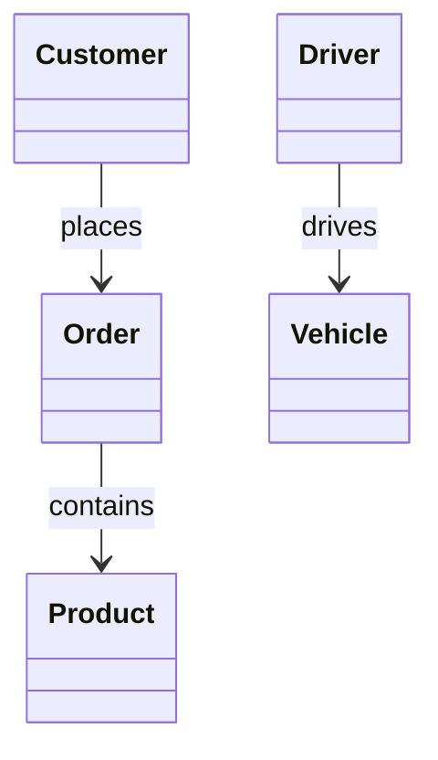

## Class Stereotypes

标记特殊的 class types：

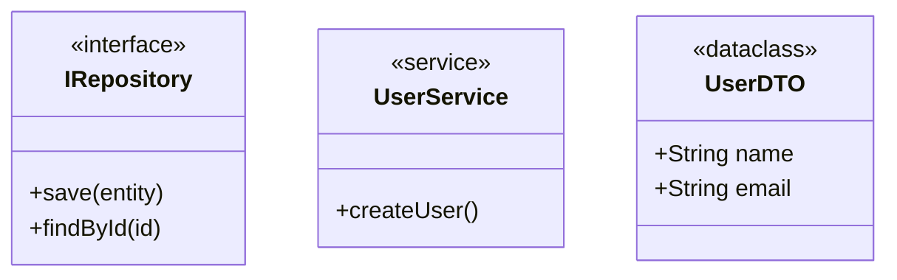

## Abstract Classes and Methods

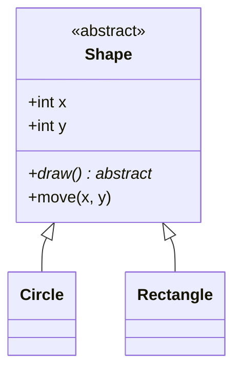

## Generic Classes

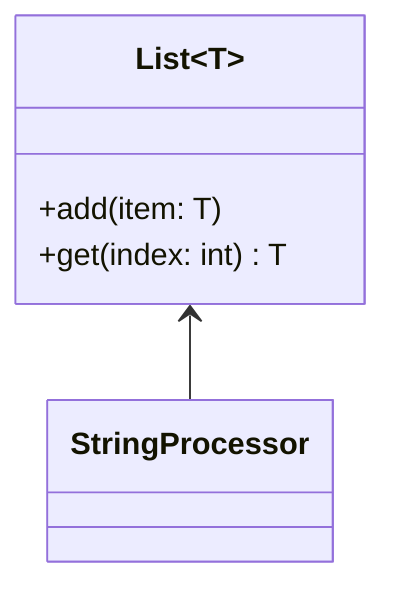

## Comprehensive Example: E-Commerce Domain

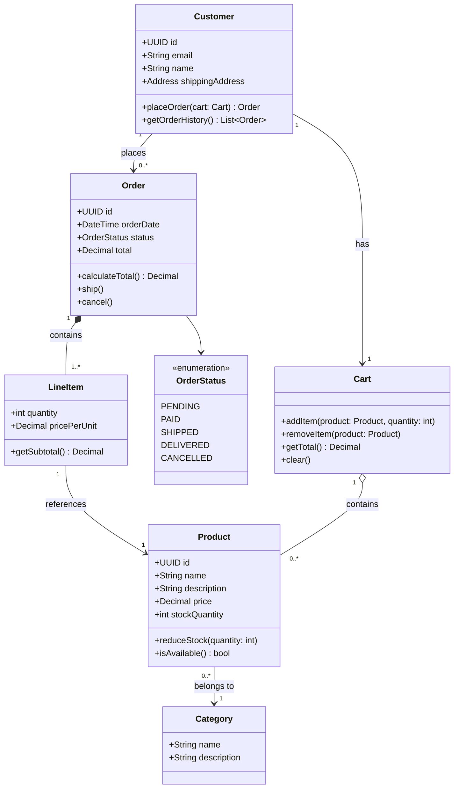

## Domain-Driven Design Patterns

### Entities
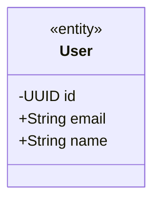

### Value Objects
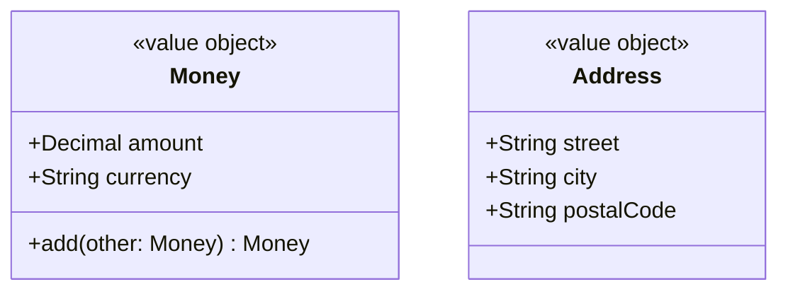

### Aggregates
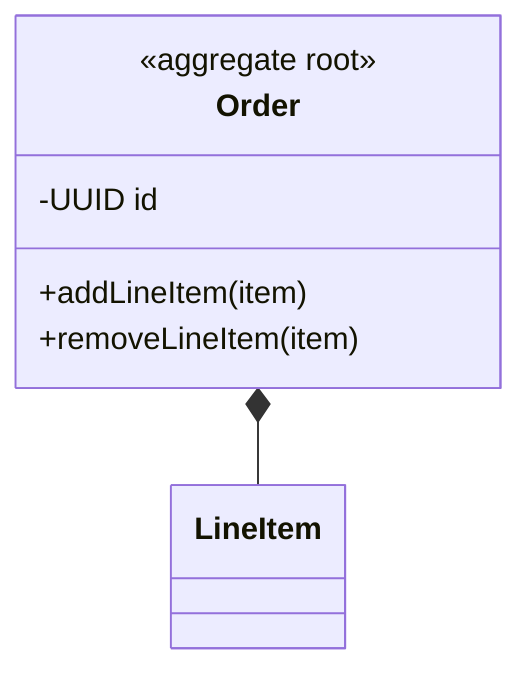

## Tips for Effective Class Diagrams

1. **从核心 entities 开始** - 逐步添加 attributes 和 methods
2. **只展示相关细节** - 除非重要，否则省略显而易见的 getters/setters
3. **使用适当的 relationships** - 谨慎选择 association、aggregation 和 composition
4. **添加 multiplicity** - 明确有多少 instances 参与
5. **为相关 classes 分组** - 使用 notes 或视觉上的邻近关系
6. **记录 invariants** - 使用 notes 解释 business rules

## Common Patterns

### Repository Pattern
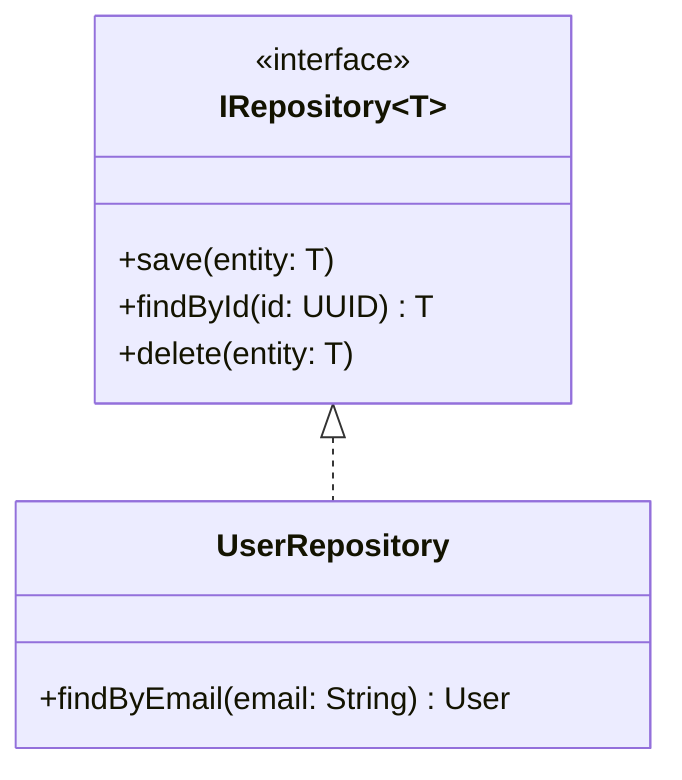

### Factory Pattern
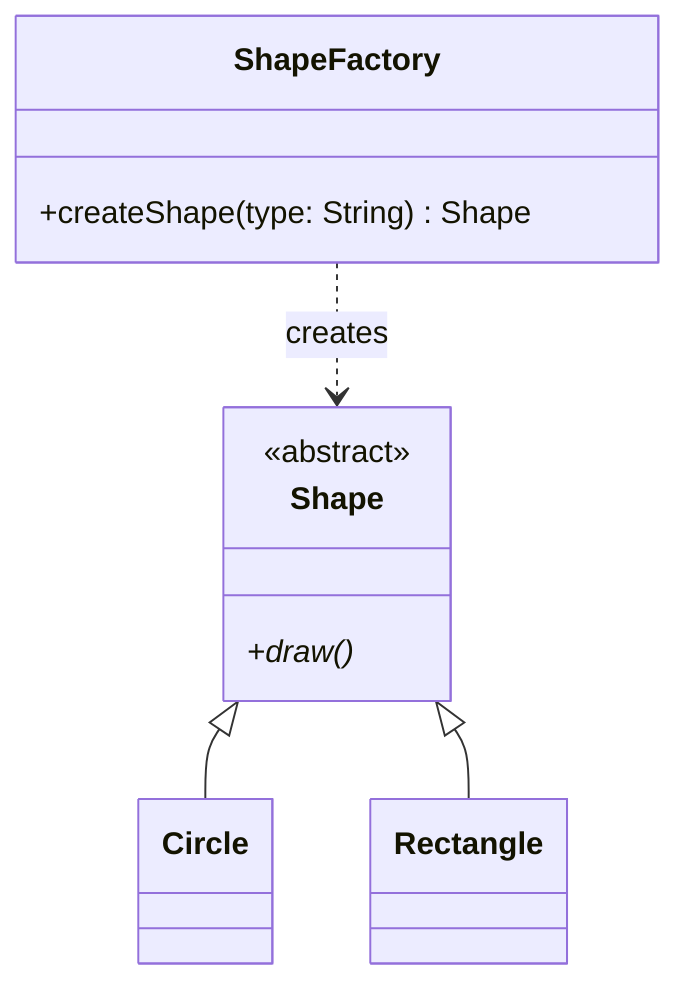

### Strategy Pattern
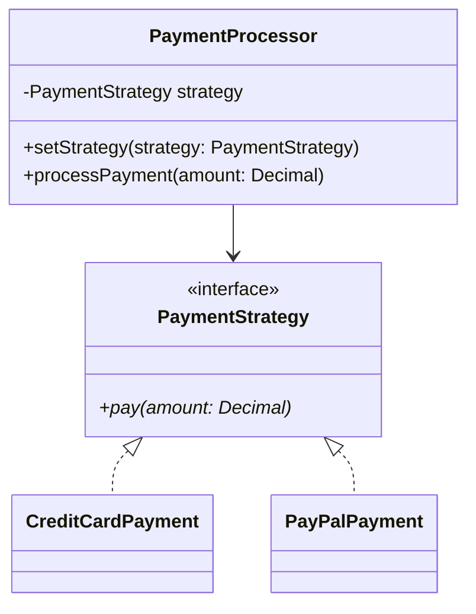
