# Entity Relationship Diagrams (ERD)

ERDs 为 database schemas 建模，展示 tables（entities）、各表的 columns（attributes）以及 tables 之间的 relationships。它们对 database design 和 documentation 必不可少。

## Basic Syntax

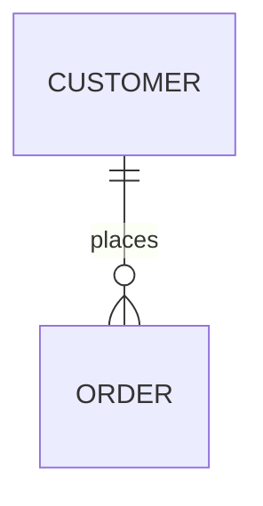

## Defining Entities

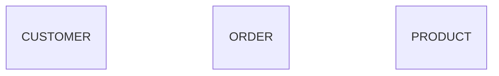

## Entity Attributes

定义 columns 的 type 和 constraints：

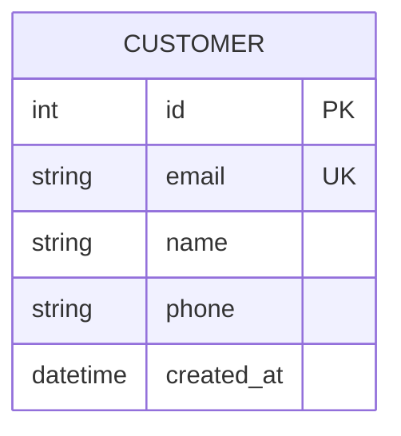

**Attribute 格式：** `type name constraints`

**常见 constraints：**
- `PK` - Primary Key
- `FK` - Foreign Key
- `UK` - Unique Key
- `NN` - Not Null

## Relationships

### Relationship Symbols

**Cardinality indicators：**
- `||` - 恰好一个
- `|o` - 零个或一个
- `}{` - 一个或多个
- `}o` - 零个或多个

**Relationship line：**
- `--` - Non-identifying relationship
- `..` - Identifying relationship（实践中少见）

### Common Relationships

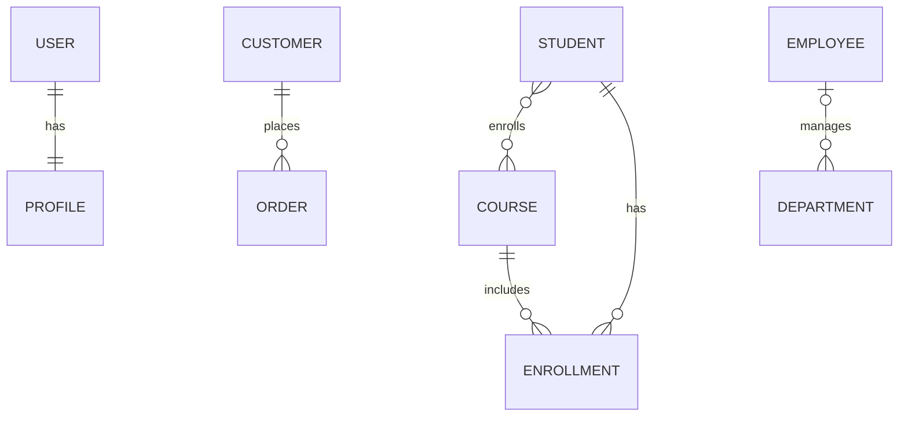

### Relationship with Labels

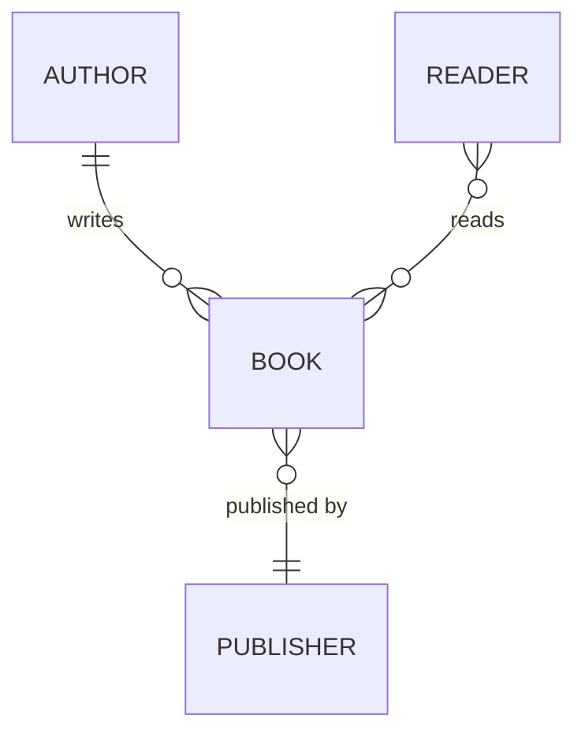

## Data Types

使用标准 database types：
- `int`, `bigint`, `smallint`
- `varchar`, `text`, `char`
- `decimal`, `float`, `double`
- `boolean`, `bool`
- `date`, `datetime`, `timestamp`
- `json`, `jsonb`
- `uuid`
- `blob`, `bytea`

## Comprehensive Example: E-Commerce Database

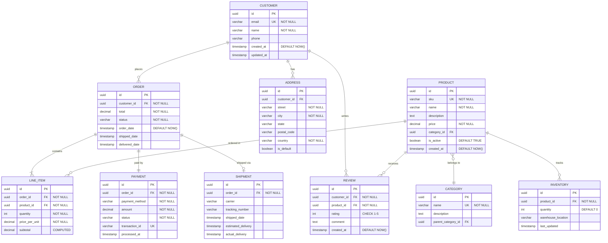

## Blog Platform Schema

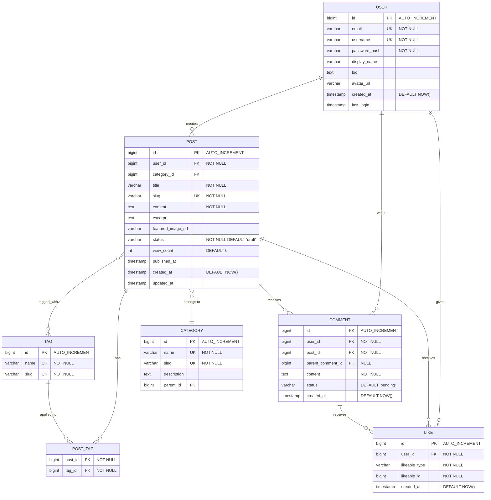

## Social Media Schema

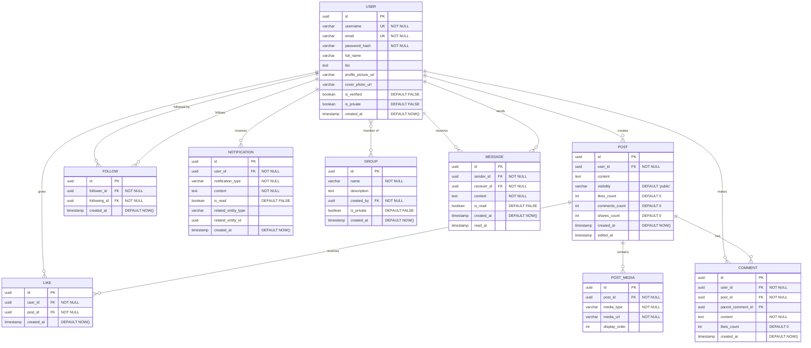

## Best Practices

1. **Entities 名称使用 UPPERCASE** - 使表达清晰的惯例
2. **使用 singular names** - `USER` 而非 `USERS`，`ORDER` 而非 `ORDERS`
3. **定义所有 constraints** - 记录 PKs、FKs、UKs、NOT NULL
4. **准确展示 cardinality** - 精确区分 one-to-many 和 many-to-many
5. **包含 timestamps** - created_at、updated_at 用于 auditing
6. **记录 computed columns** - 标记 calculated/derived values
7. **添加有意义的 comments** - 为 constraints 和 descriptions 使用引号
8. **考虑 junction tables** - 显式建模 many-to-many relationships
9. **使用适当的 types** - 匹配 database-specific types
10. **展示 indexes** - 除 PKs 外，也记录 UK（unique keys）

## Common Patterns

### Self-Referencing (Hierarchical)
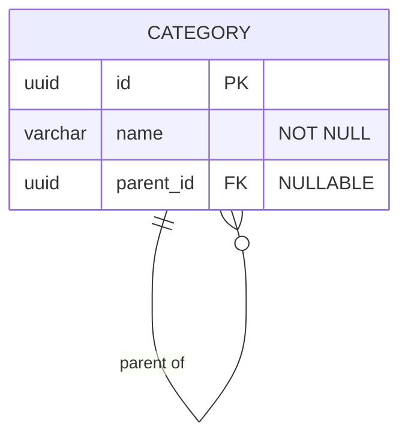

### Junction Table (Many-to-Many)
```mermaid
erDiagram
    STUDENT }o--o{ COURSE : enrolls
    STUDENT ||--o{ ENROLLMENT : has
    COURSE ||--o{ ENROLLMENT : includes
    
    STUDENT {
        uuid id PK
        varchar name "NOT NULL"
    }
    
    ENROLLMENT {
        uuid student_id FK PK
        uuid course_id FK PK
        date enrolled_date
        varchar grade
    }
    
    COURSE {
        uuid id PK
        varchar title "NOT NULL"
    }
```

### Polymorphic Relationship
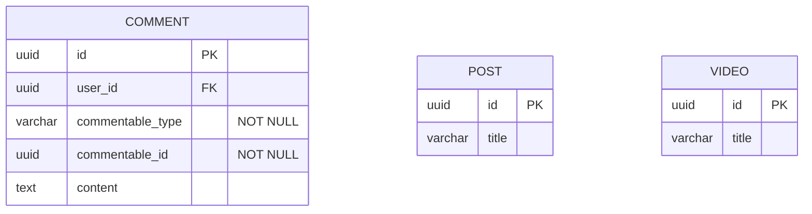

### Soft Deletes
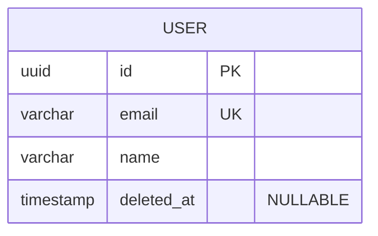

### Audit Trail
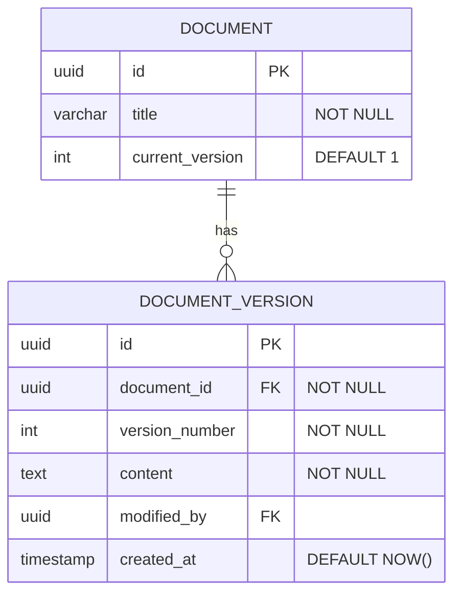

## Tips for Database Design

1. **适度 normalize** - 平衡 normalization 与 query performance
2. **使用 surrogate keys** - 将 UUID 或 auto-increment integers 作为 PKs
3. **为 foreign keys 建立 index** - 对 join performance 至关重要
4. **规划 soft deletes** - 添加 deleted_at columns，而不是进行 hard deletes
5. **为关键 data 保留 version** - 维护重要 entities 的 history
6. **设置适当的 defaults** - created_at、status、boolean flags
7. **考虑 denormalization** - 为提高 performance 保存 counts 和 cached values
8. **使用 enum/check constraints** - 在 database 层确保 values 有效
