# Entity Relationship Diagrams (ERD)

ERD 用于建模数据库 schema，展示表（实体）、列（属性）以及表之间的关系，是数据库设计与文档的重要工具。

## Basic Syntax

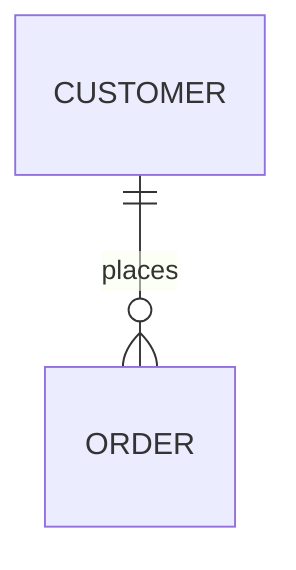

## Defining Entities

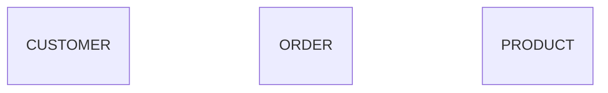

## Entity Attributes

定义列的类型与约束：

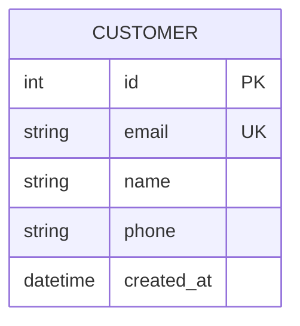

**属性格式：** `type name constraints`

**常见约束：**
- `PK` -- 主键
- `FK` -- 外键
- `UK` -- 唯一键
- `NN` -- 非空

## Relationships

### Relationship Symbols

**基数标记：**
- `||` -- 恰好一个
- `|o` -- 零个或一个
- `}{` -- 一个或多个
- `}o` -- 零个或多个

**关系连线：**
- `--` -- 非标识关系
- `..` -- 标识关系（实际较少使用）

### Common Relationships

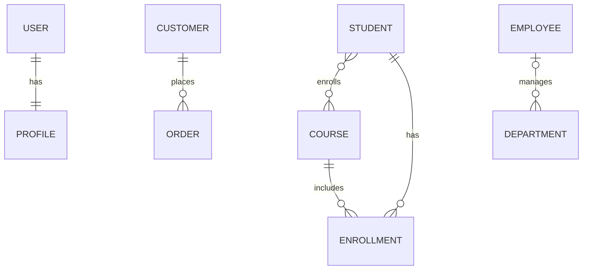

### Relationship with Labels

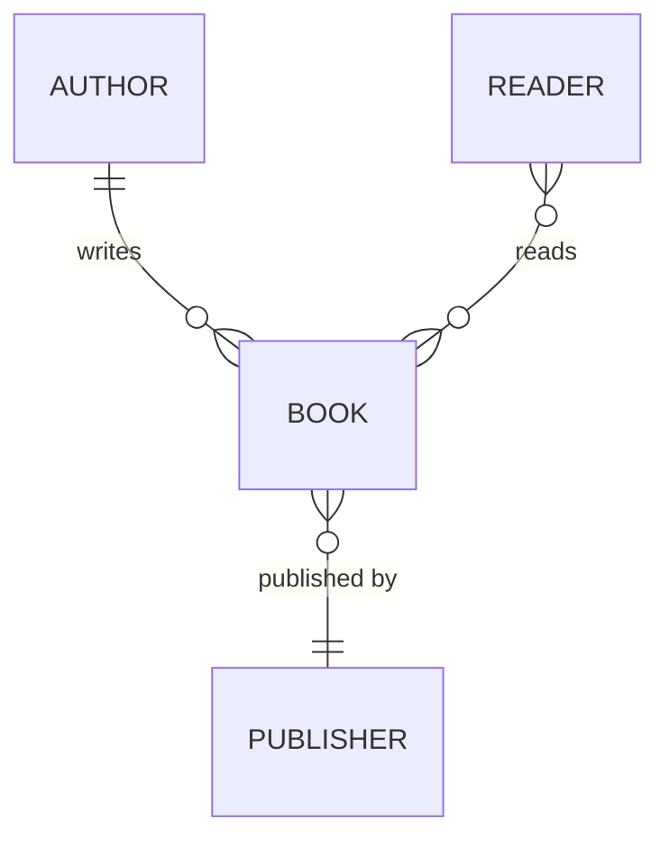

## Data Types

使用标准数据库类型：
- `int`, `bigint`, `smallint`
- `varchar`, `text`, `char`
- `decimal`, `float`, `double`
- `boolean`, `bool`
- `date`, `datetime`, `timestamp`
- `json`, `jsonb`
- `uuid`
- `blob`, `bytea`

## Comprehensive Example: E-Commerce Database

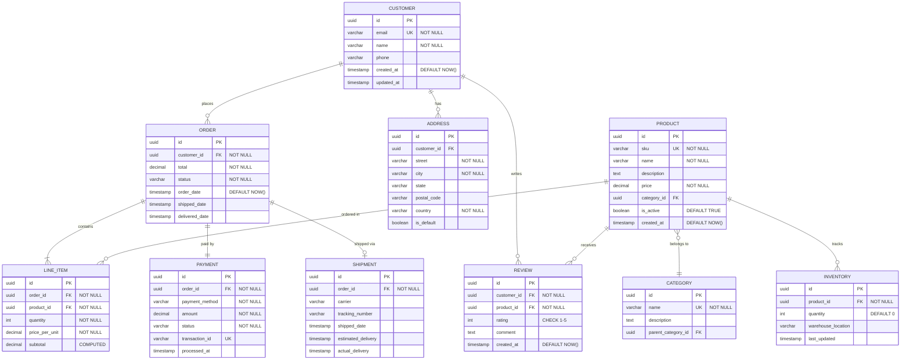

## Blog Platform Schema

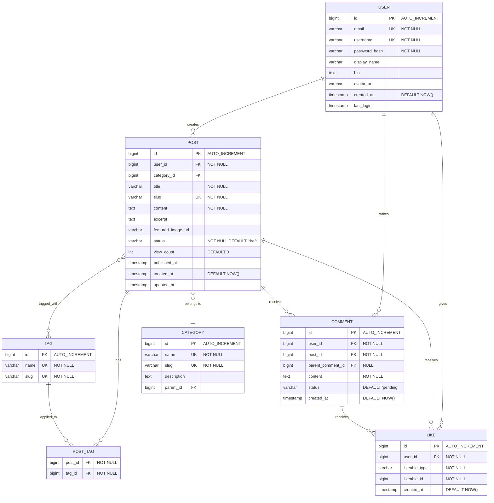

## Social Media Schema

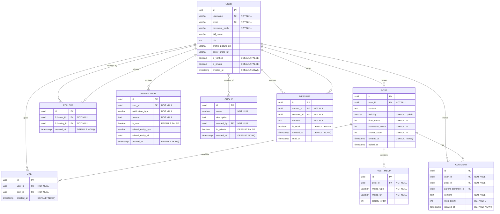

## Best Practices

1. **实体名使用大写** -- 提高清晰度的命名惯例
2. **使用单数名** -- `USER` 而非 `USERS`，`ORDER` 而非 `ORDERS`
3. **定义所有约束** -- 记录 PK、FK、UK、NOT NULL
4. **准确展示基数** -- 明确区分一对多与多对多
5. **加入时间戳** -- created_at、updated_at 用于审计
6. **记录计算列** -- 标记计算或派生值
7. **添加有意义的注释** -- 用引号标注约束和说明
8. **考虑关联表** -- 显式建模多对多关系
9. **使用适当类型** -- 匹配具体数据库的类型
10. **展示索引** -- 除 PK 外，也记录 UK（唯一键）

## Common Patterns

### Self-Referencing (Hierarchical)
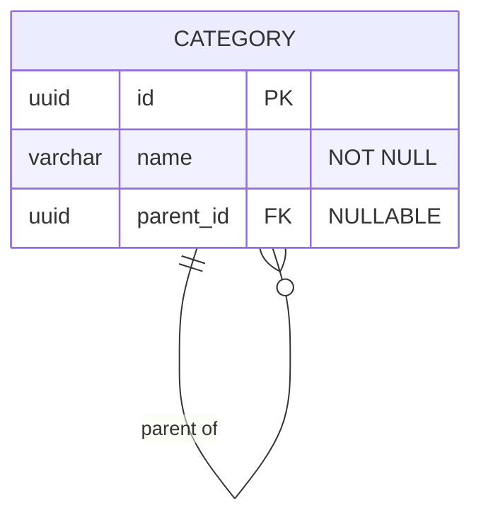

### Junction Table (Many-to-Many)
```mermaid
erDiagram
    STUDENT }o--o{ COURSE : enrolls
    STUDENT ||--o{ ENROLLMENT : has
    COURSE ||--o{ ENROLLMENT : includes
    
    STUDENT {
        uuid id PK
        varchar name "NOT NULL"
    }
    
    ENROLLMENT {
        uuid student_id FK PK
        uuid course_id FK PK
        date enrolled_date
        varchar grade
    }
    
    COURSE {
        uuid id PK
        varchar title "NOT NULL"
    }
```

### Polymorphic Relationship
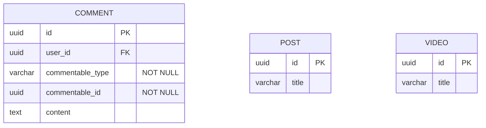

### Soft Deletes
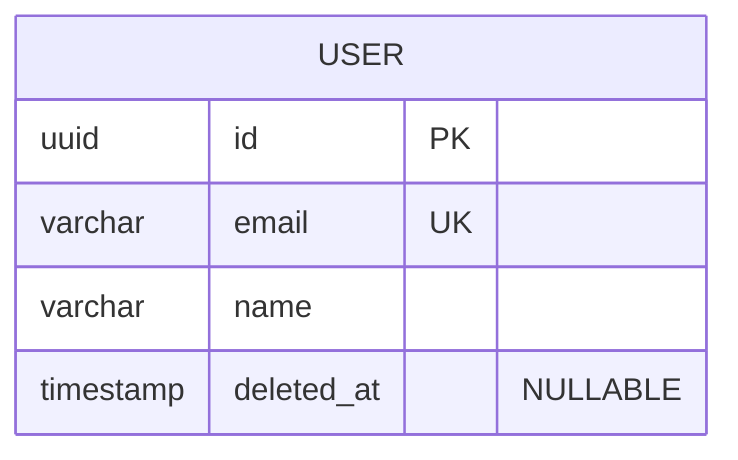

### Audit Trail
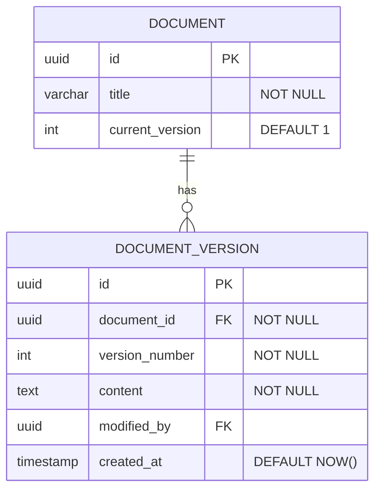

## Tips for Database Design

1. **适度规范化** -- 平衡规范化与查询性能
2. **使用代理键** -- UUID 或自增整数作为 PK
3. **为外键建索引** -- 对连接查询性能很重要
4. **规划软删除** -- 增加 deleted_at 列，替代物理删除
5. **关键数据保留版本** -- 为重要实体维护历史
6. **设置适当默认值** -- created_at、status、布尔标记
7. **考虑反规范化** -- 为性能保存计数或缓存值
8. **使用 enum/check 约束** -- 在数据库层保证取值有效
