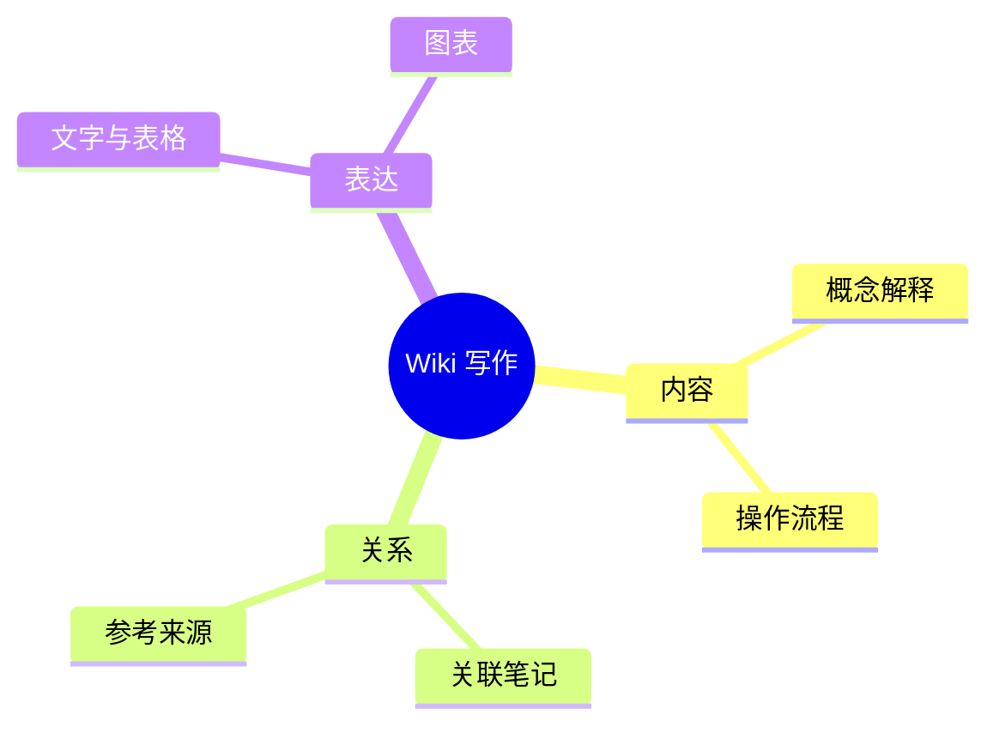

# Mermaid Mind Maps

Use `mindmap` for a single rooted hierarchy: topic breakdowns, concept categories, or a knowledge outline. For branching execution, use a flowchart; for calls over time, use a sequence diagram. Cross-links and multiple parents need a graph rather than a mind map.

## Markdown example

````markdown

````

Indentation defines parent and child relationships. Use spaces consistently; siblings start in the same column. Keep one root and short noun phrases. The `root` identifier is English; visible labels follow the document's language.

## Writing decisions

- Group by one organizing principle at each level. Avoid mixing categories, actions, and implementation details as equivalent siblings unless the explanation calls for it.
- Use the minimum depth needed to answer the reader's question. Split a crowded branch into another focused diagram or an ordinary section.
- Put long definitions, exceptions, and evidence in adjacent prose. The map shows structure and does not replace those explanations.
- Use default shapes and the host theme first. Icon fonts, additional layouts, and custom classes depend on integration and should not be assumed available.
- Validate with the target Mermaid version locally when available, then distinguish parsing success from actual layout verification. Do not send private Wiki material to an online editor.

This reference covers Mermaid `mindmap` syntax, not `.canvas` files or `.base` database views. Public Markdown output stays in a fenced `mermaid` block unless another artifact was requested.

Source: [Mermaid mindmap documentation](https://mermaid.js.org/syntax/mindmap.html), consulted 2026-10-26. This is locally written guidance; it is not part of the upstream `softaworks/agent-toolkit` snapshot.
