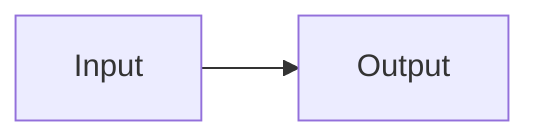
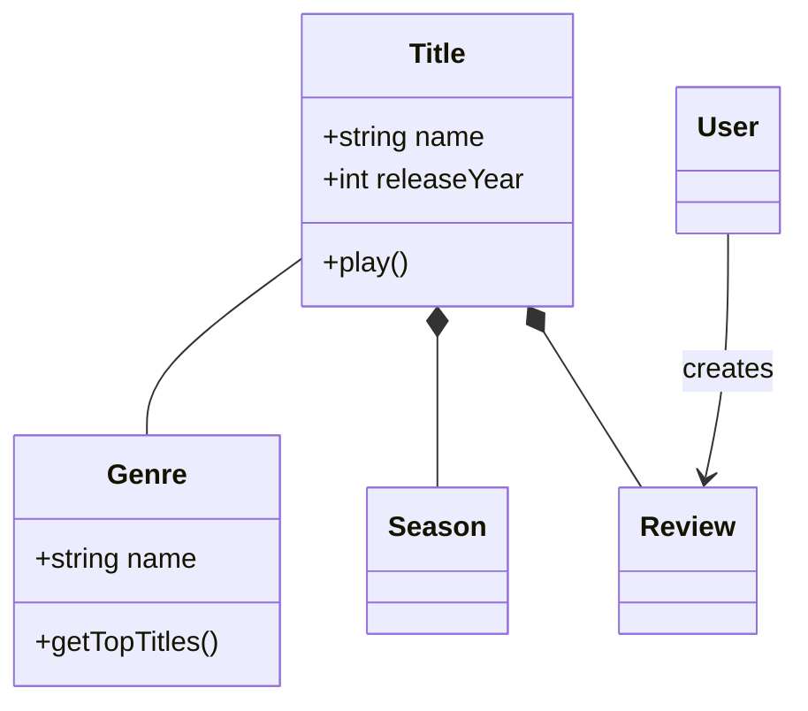
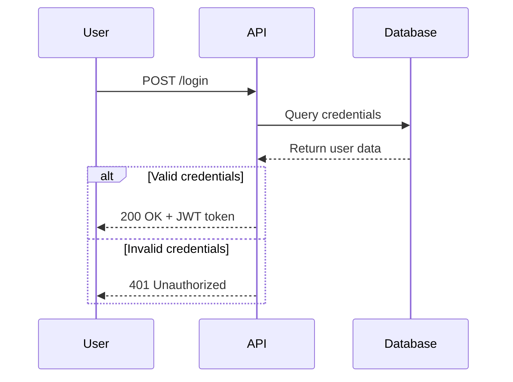
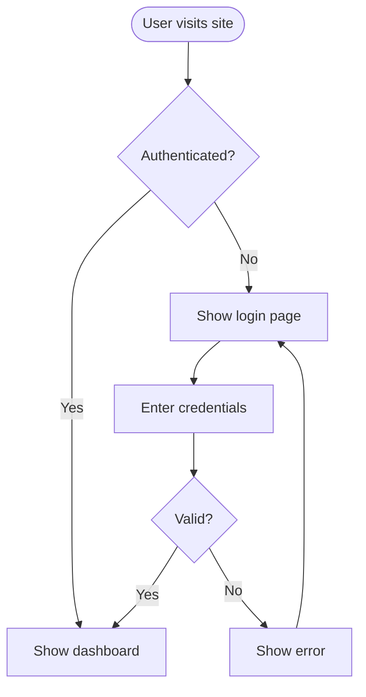
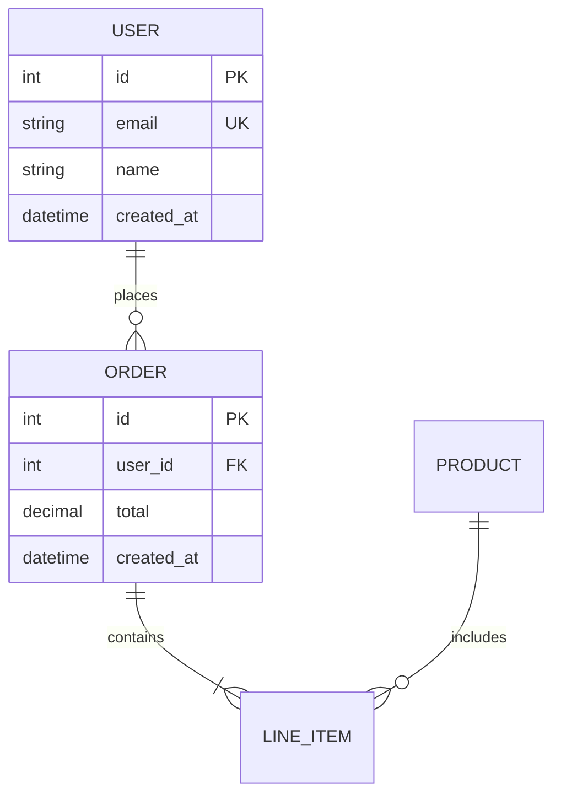
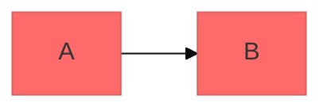

# Mermaid Diagramming

Create professional software diagrams using Mermaid's text-based syntax. Mermaid renders diagrams from simple text definitions, making diagrams version-controllable, easy to update, and maintainable alongside code.

## Workflow

1. Identify the question the diagram should answer and the facts supporting its nodes and relationships. A diagram should make the explanation easier to understand; simple steps or field comparisons usually need only a list or table.
2. Choose a diagram type below, then read only its relevant reference. Use a mind map for a hierarchy, a flowchart for branching or dependencies, and a sequence diagram for interactions over time.
3. Return a fenced `mermaid` block for Markdown documents. Create a separate `.mmd`, SVG, or image only when the requested deliverable needs it. Keep labels in the document's language and identifiers in English.
4. Use one diagram per question, keep labels short, and explain the key conclusion in adjacent prose. Preserve supplied relationships and mark uncertainty instead of inventing nodes or edges.
5. Check syntax locally with the target renderer's Mermaid version when available. Report syntax validation and visual verification separately; an unexecuted diagram has not been verified by rendering.

The calling workflow owns source access, destination paths, preview, Git, and publication. In Wiki workflows, use only the minimal concepts and relationships permitted for public output; do not read or pass private Wiki source, user configuration, project routes, or credentials to this skill or rendering services. Return the diagram to the caller without starting another write or publication flow.

The local output and validation rules in this entrypoint take precedence over installation, external services, icons, and styling examples in upstream references. Source provenance is recorded in [references/UPSTREAM.md](references/UPSTREAM.md).

## Core Syntax Structure

All Mermaid diagrams follow this pattern:

**Key principles:**
- First line declares diagram type (e.g., `classDiagram`, `sequenceDiagram`, `flowchart`)
- Use `%%` for comments
- Line breaks and indentation improve readability but aren't required
- Unknown words break diagrams; parameters fail silently

## Diagram Type Selection Guide

**Choose the right diagram type:**

**Mind Maps** (`mindmap`) - Concept hierarchies, topic breakdowns, and knowledge outlines. Read [references/mindmaps.md](references/mindmaps.md). Use another diagram type when cross-links, execution order, or multiple parents are essential.

1. **Class Diagrams** - Domain modeling, OOP design, entity relationships
   - Domain-driven design documentation
   - Object-oriented class structures
   - Entity relationships and dependencies

2. **Sequence Diagrams** - Temporal interactions, message flows
   - API request/response flows
   - User authentication flows
   - System component interactions
   - Method call sequences

3. **Flowcharts** - Processes, algorithms, decision trees
   - User journeys and workflows
   - Business processes
   - Algorithm logic
   - Deployment pipelines

4. **Entity Relationship Diagrams (ERD)** - Database schemas
   - Table relationships
   - Data modeling
   - Schema design

5. **C4 Diagrams** - Software architecture at multiple levels
   - System Context (systems and users)
   - Container (applications, databases, services)
   - Component (internal structure)
   - Code (class/interface level)

6. **State Diagrams** - State machines, lifecycle states
7. **Git Graphs** - Version control branching strategies
8. **Gantt Charts** - Project timelines, scheduling
9. **Pie/Bar Charts** - Data visualization

## Quick Start Examples

### Class Diagram (Domain Model)

### Sequence Diagram (API Flow)

### Flowchart (User Journey)

### ERD (Database Schema)

## Detailed References

For in-depth guidance on specific diagram types, see:

- **[references/class-diagrams.md](references/class-diagrams.md)** - Domain modeling, relationships (association, composition, aggregation, inheritance), multiplicity, methods/properties
- **[references/sequence-diagrams.md](references/sequence-diagrams.md)** - Actors, participants, messages (sync/async), activations, loops, alt/opt/par blocks, notes
- **[references/flowcharts.md](references/flowcharts.md)** - Node shapes, connections, decision logic, subgraphs, styling
- **[references/erd-diagrams.md](references/erd-diagrams.md)** - Entities, relationships, cardinality, keys, attributes
- **[references/c4-diagrams.md](references/c4-diagrams.md)** - System context, container, component diagrams, boundaries
- **[references/architecture-diagrams.md](references/architecture-diagrams.md)** - Cloud services, infrastructure, CI/CD deployments
- **[references/advanced-features.md](references/advanced-features.md)** - Themes, styling, configuration, layout options
- **[references/mindmaps.md](references/mindmaps.md)** - Hierarchy, indentation, concise labels, and a Markdown-ready mind map

## Best Practices

1. **Start Simple** - Begin with core entities/components, add details incrementally
2. **Use Meaningful Names** - Clear labels make diagrams self-documenting
3. **Explain Non-obvious Choices** - Use `%%` comments only where they clarify a relationship or assumption
4. **Keep Focused** - One diagram per concept; split large diagrams into multiple focused views
5. **Keep Source Editable** - Keep diagrams in the requested Markdown; use `.mmd` files when a separate source artifact is requested
6. **Add Context** - Include titles and notes to explain diagram purpose
7. **Iterate** - Refine diagrams as understanding evolves

## Configuration and Theming

Configure diagrams using frontmatter:

**Available themes:** default, forest, dark, neutral, base

**Layout options:**
- `layout: dagre` (default) - Classic balanced layout
- `layout: elk` - Advanced layout for complex diagrams (requires integration)

**Look options:**
- `look: classic` - Traditional Mermaid style
- `look: handDrawn` - Sketch-like appearance

## Exporting and Rendering

Use the caller's existing renderer and its actual supported features. A Mermaid version number alone does not establish that optional layouts, fonts, icon packs, or node interactions are integrated.

- Prefer local validation. If Mermaid CLI is already available and an image is requested, use `mmdc -i input.mmd -o output.svg` or the requested output format.
- For `pubwiki-markdown`, return the code block to that skill; its existing preview and publication workflow owns rendering. Do not invoke an exporter with the original Vault.
- Use external editors or rendering services only for material already permitted for public output. Private Wiki source, user configuration, project routes, and credentials stay outside these services.
- Do not install dependencies, change renderer configuration, or build an application just to generate a document diagram.

## Common Pitfalls

- **Breaking characters** - Quote labels containing syntax delimiters and check escaping with the target parser
- **Syntax errors** - Check diagram keywords, identifiers, indentation, and reserved words locally
- **Overcomplexity** - Split complex diagrams into multiple focused views
- **Missing relationships** - Document all important connections between entities

## When to Create Diagrams

Create a diagram when the user requests one, an existing diagram needs an update, or visualizing relationships materially improves the explanation. Keep ordinary prose, lists, and tables when they already explain the content clearly. There is no required diagram count per article, feature, or project.
